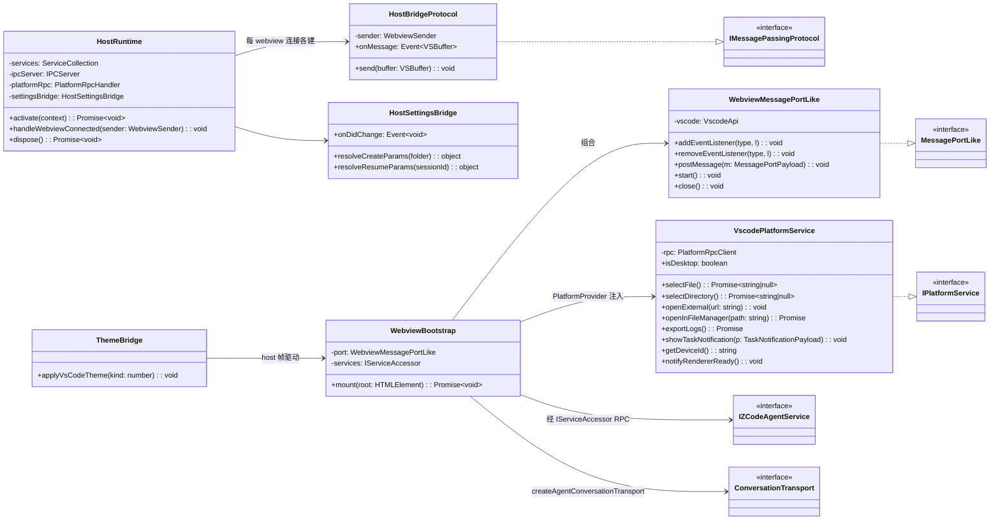
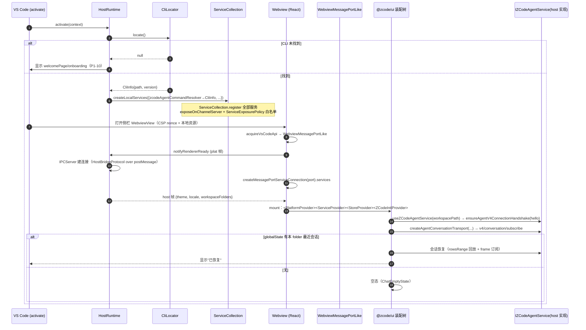
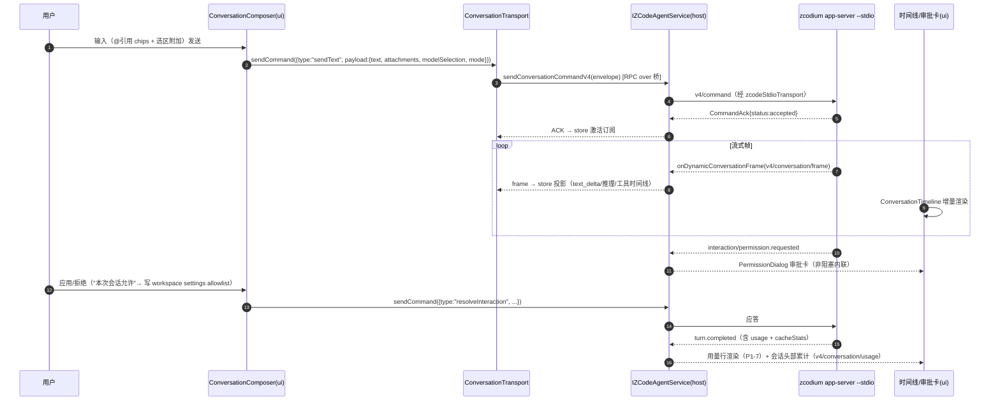
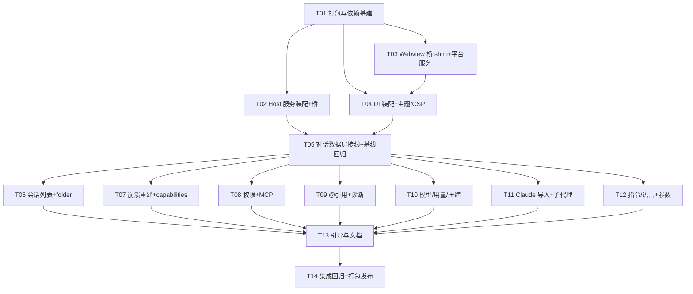

# ZCodium VS Code 插件 v0.2.0 增量架构设计（P1）

- 作者：架构师 高见远（Bob / software-architect）
- 输入：`docs/prd-p1.md`（许清楚）+ 基线 `docs/architecture.md`（T1–T9 已交付，commit ddd55712）+ 仓库实地勘察（packages/ui、packages/client、packages/rpc、packages/services、packages/web、apps/zcode-cli）+ 主理人实测证据包
- 主理人已拍板：① 直接依赖 `@zcode/shared|services|client`，删除手工同步 types.ts；② UI 复用 `@zcode/ui`（硬依赖逐项 shim，不推翻）；③ A/A+ 档全做，B 档下期；④ 排除 inline 补全与代码库索引

---

## 0. 结论速览

| 项 | 结论 |
|---|---|
| `@zcode/ui` 复用可行性 | **可行，不推翻**。实证：UI 平台耦合全部收敛到 `IPlatformService`（React Context 注入，`usePlatform.tsx` 头注明确"替代直接调用 window.zcode"）与 `IServiceAccessor`（RPC 注入）两个缝；`ui/src` 中 Electron/window.zcode 直接引用仅 7 个文件（全属桌面壳/更新组件，聊天面不挂载）；`packages/web` 已在纯浏览器运行同一 UI |
| 通信桥 | 复用 `@zcode/rpc` 的 `IMessagePassingProtocol`（send/onMessage 两方法）+ `MessagePortLike`（5 方法），Webview postMessage 伪装成 MessagePort；host 侧 = `IPCServer` + `ServiceCollection`，RPC 栈零新代码 |
| v4 vs legacy | **全面走 v4**：`IZCodeAgentService` v4 转发面 + `v4/command` 命令面（`switchModelConfig`/`switchCollaborationMode`/`compact`/`deleteSession`/`renameSession`/goal 族/cancelBackgroundWork 全部在案，`packages/shared/src/zcode-protocol-v4/command.ts`） |
| Claude Code 导入 | **插件不做 jsonl 解析**——`@zcode/services/src/session/claude-native/` 已有完整实现（parser/repo/service/persist），UI 已有 `useClaudeSessionMigration` hook；插件只需 `isDesktop=true` 平台位 + 入口 UI |
| CLAUDE.md 自动读取 | CLI 运行时**不自动读**规则文件（core/src 中 CLAUDE.md 仅出现在 memory.ts/dream.ts 的"不要重复"提示；无 AGENTS.md/ZCODIUM.md 加载器）；P1-13 = 纯设置面 + "从 CLAUDE.md 一次性导入"按钮 |
| 会话真删除 | **v4 `deleteSession` 命令存在** → P1-1 可升级为真删除（推翻 PRD"无删除方法"的初判） |
| 基线重构 | 删 `src/zcodeProtocol/types.ts`、`src/protocol/*`、`src/webview/*`、`src/session/*` 大部；保留 cliLocator/diffViewer/statusBar/diagnostics/store/welcomePage；架构政策 requires 改为 [shared, services, client, ui] |

---

## 1. `@zcode/ui` 复用可行性报告（P1-9.5 交付物）

### 1.1 关键架构事实（实地勘察）

1. **平台耦合唯一入口是 `IPlatformService`**（`packages/shared/src/platform.ts`，~60KB 接口，方法绝大多数为可选 `?`）。`hooks/usePlatform.tsx`：`PlatformProvider({platform})` + `usePlatform()`，纯 React Context 注入——**UI 不摸 window.zcode，注入什么用什么，无需改 ui 包**。
2. **业务数据全部走 `IServiceAccessor` RPC**：组件经 `ServiceProvider`/`useWorkspaceServices`（Context 注入）拿服务代理；v4 对话数据层经 `ConversationTransport`（`v4/transport.ts`，纯接口）→ `createAgentConversationTransport(agentService: IZCodeAgentService, {workspacePath})`（`v4/agentConversationTransport.ts`，577 行，ui 包内现成实现）桥到 `IZCodeAgentService`。
3. **传输层完全传输无关**：`@zcode/rpc/src/protocol.ts`——`IMessagePassingProtocol { send(VSBuffer); onMessage: Event<VSBuffer> }` 是腰部抽象，"只要实现 send() 和 onMessage，就能接入整个 RPC 框架"；`MessagePortLike` 仅 5 方法（addEventListener/removeEventListener/postMessage/start/close）。`@zcode/client/createMessagePortServiceConnection(port) → {services: IServiceAccessor, dispose}` 即客户端连接全貌。
4. **纯浏览器先例**：`packages/web/src/main.tsx` 在普通浏览器装配同一 UI（`connectViaWebSocket` + web 版 IPlatformService + `import "@zcode/ui/styles.css"` + 主题 class 初始化）。Webview 沙箱 ≈ 浏览器 + vscode.postMessage 通道，环境严格度不高于 web 端已验证场景。
5. **宿主侧装配范式**：`packages/services/src/collection.ts` `ServiceCollection.register(descriptor, instance)` + `exposeOnChannelServer(server)`；`packages/services/src/node.ts` `createLocalServices(options): ServiceCollection` 是官方宿主装配入口（desktop host 即此模式）；`packages/rpc/src/ipc.ts` `IPCServer(onDidClientConnect)` 为每个连接建 `ChannelServer`。
6. **主题/i18n/样式**：Tailwind v4（`@import "tailwindcss"`）+ CSS vars + `dark`/`theme-zai-light|dark` class；主题持久化 `localStorage["zcode-theme"]`；i18n 经 `ZCodeIntlProvider` 注入。Webview 均可用。

### 1.2 硬依赖清单与 shim 表

| # | 依赖点 | Webview 可满足？ | 处置 |
|---|---|---|---|
| H1 | `IPlatformService` 桌面专有方法（update/browserView/CUA/webRemoteControl/remote-relay/SSH/WSL/docker/zoom/fullscreen 等约 40 个） | ✅ 几乎全为可选 | `VscodePlatformService`：能力内方法走宿主 RPC 代理；不可代理返回 no-op/false/"unsupported"，**不抛错**（P1-9.3）。矩阵见 §2.4 |
| H2 | `MessagePort` 形态服务连接 | ✅ | `WebviewMessagePortLike : MessagePortLike`（5 方法），见 §2.2 |
| H3 | RPC 二进制载荷（`Uint8Array`）过 `vscode.postMessage`（JSON 序列化） | ⚠ | 桥两侧 base64 编解码，收发端还原为 Uint8Array 再进 `MessagePortProtocol`；大载荷缓解见 §8 R1 |
| H4 | Electron 直接引用 7 文件：`DesktopWindowControls/DesktopTopOverlay/DesktopOverlayWindowControls/useDesktopZoomFactor/UpdateStatusButton|Dialog|Controller/logger/ConversationShareReadonlyTimeline` | ✅ | 复用边界**排除**（聊天面不挂载）；`logger.ts` 若被传递闭包引用，用 esbuild alias 替换为 webview 轻量 logger |
| H5 | `mcpStoreDesktop.ts` 等桌面分支 | ✅ | 走 web 分支（与 packages/web 同路径） |
| H6 | `useTheme` 的 matchMedia/localStorage/document | ✅ | 初始主题由插件注入；`system` 值由宿主主题变更帧驱动 |
| H7 | `useClaudeSessionMigration` 的 `isDesktop` 门 | ✅ | 平台位返回 **true**（extension host 真实读本机 `~/.claude/projects`） |
| H8 | xterm/pdfjs/lexical/stripe/rive/recharts/shiki 重依赖 | ✅ 纯浏览器库 | 按装配面 cherry-pick + tree-shake（§7）；stripe/rive/xterm/pdfjs 不进装配闭包则不进 bundle |
| H9 | `window.zcode` 直访 | ✅ | UI 无直接引用（被 IPlatformService 替代，实测 0 处）；oxlint no-restricted-globals 守护 |
| H10 | Node 内建模块 | ✅ | esbuild webview 构建固定 `platform: browser`，node import 构建期即失败（护栏） |

### 1.3 复用边界（用 / 包一层 / 排除）

- **直接用（零改动）**：消息流/时间线（ModelTrajectory*、ToolCallBlocks）、流式渲染、`LexicalChatInput`/`ConversationComposer`、`ChatEmptyState`/`ChatErrorBanner`、`PermissionDialog`（审批卡）、`ElicitationDialog`（P1-16 反向提问）、mentions/prompt-editor（P1-4 @ 引用基座）、`SubagentDrilldown`/`subagentsStore`（P1-15）、用量展示、`useClaudeSessionMigration`（P1-12）、Confirm/Alert 宿主、主题/i18n。
- **包一层（插件装配代码）**：`ConversationTransport`（services 代理 + workspacePath 装配）、`IPlatformService`（§2.4）、会话列表（`TaskList`/`sessionsIndexStore` 消费 host 的 sessionsIndex 通道）、插件顶栏（PRD §6 ASCII 稿：folder/模型/模式/用量入口，用 ui 子集组件拼）。
- **排除**：`Root/RootShell` 全桌面壳、`Desktop*` 组件族、`WebRemoteControl*`、`GitPane/Terminal/PreviewPane/WhiteboardPane`（编辑器场景由 VS Code 原生面板替代）、更新族组件。
- **[实现期待核实]** `App.tsx`（1383 行）是否有"仅对话区"布局档；若没有则以 `V4WorkspaceChatArea`/`SessionPane` + 自拼顶栏为装配面（仍属"包一层"）。

---

## 2. 通信桥与 IPlatformService 设计

### 2.1 总体拓扑

```
┌─ VS Code Extension Host (Node) ────────────────────────────┐
│ HostRuntime                                                 │
│  ├ CliLocator（保留）→ zcodeAgentCommandResolver             │
│  ├ createLocalServices(...) → ServiceCollection             │
│  │    └ ZCodeAgentService（zcodeStdioTransport spawn          │
│  │       zcodium app-server --stdio + ProcessManager）        │
│  ├ IPCServer(onDidClientConnect → HostBridgeProtocol)        │
│  ├ PlatformRpcHandler（平台能力 RPC host 端，方法白名单）      │
│  └ HostSettingsBridge（zcodium.* settings → create/resume 参数）│
└──────────────┬──────────────────────────────────────────────┘
               │ vscode.postMessage / onDidReceiveMessage
               │  帧型：{t:"rpc"| "flow" | "plat-*" | "host"}
┌──────────────▼──────────────────────────────────────────────┐
│ Webview (iframe sandbox, CSP nonce)                          │
│  WebviewMessagePortLike : MessagePortLike（base64 shim）      │
│   └ MessagePortProtocol → ChannelClient → RemoteServiceAccess│
│      = createMessagePortServiceConnection(port).services      │
│  React 装配：PlatformProvider(VscodePlatformService)           │
│   + ServiceProvider(services) + StoreProvider(broadcast)      │
│   + ZCodeIntlProvider + ThemeBridge + V4 对话区               │
└──────────────────────────────────────────────────────────────┘
```

extension host 扮演桌面架构中 utilityProcess(host) 的角色，webview 扮演 renderer。协议帧与平台帧共用一条 postMessage 通道、顶层 `t` 字段分流；除此之外 RPC 栈全部复用。

### 2.2 桥 wire 协议（唯一自定义 wire，两侧 schema 校验）

```ts
type BridgeEnvelope =
  | { t: "rpc"; b64: string }                          // @zcode/rpc VSBuffer（base64）
  | { t: "flow"; state: "saturated" | "drained" }       // MessagePort 流控透传
  | { t: "plat-req"; id: number; method: string; args: unknown[] }
  | { t: "plat-res"; id: number; ok: true; value: unknown }
  | { t: "plat-res"; id: number; ok: false; error: string }
  | { t: "plat-evt"; event: string; payload: unknown }  // host→webview 平台事件
  | { t: "host"; kind: "theme" | "locale" | "workspace" | "visibility"; payload: unknown };
```

- `rpc`/`flow`：base64 ↔ Uint8Array 后进 `MessagePortProtocol`（该类对非 Uint8Array 消息天然丢弃，`t` 字段隔离充分）。
- `plat-*`：`VscodePlatformService` ↔ `PlatformRpcHandler` 小 RPC；host 端**方法白名单**校验（selectFile/selectDirectory/openExternal/openInFileManager/exportLogs/getDeviceId 等），杜绝 webview 侧任意调用 VS Code API。
- `host`：主题/locale/工作区 folder/可见性推送（webview 隐藏时暂停渲染）。

### 2.3 类图



### 2.4 IPlatformService VS Code 实现面（MVP 装配矩阵）

| 方法组 | 处置 |
|---|---|
| `selectDirectory/selectFile`（必选） | plat-req → host `showOpenDialog` / QuickPick |
| `openExternal`（必选） | → `env.openExternal(Uri.parse)` |
| `openInFileManager`（必选） | → `env.openExternal(Uri.file, {revealIfVisible:true})` |
| `openFeedback/openCommunity/canOpenCommunity` | → openExternal 固定 URL；can 返回 true |
| `notifyRendererReady`（必选） | 触发 host 下发主题/locale/workspace/可见性 |
| `showTaskNotification`（必选） | → `window.showInformationMessage`（点击聚焦侧栏） |
| `onTaskNotificationClick/onFocusTab/onNewTab/onNewTask/onOpenWorkspace/onWindowFullscreenChanged` | 返回真实 unsubscribe 的空监听（no-op） |
| `syncWindowTabs/syncWindowUnreadCount/syncActiveTaskSession` | unread → 状态栏角标（经 host 帧）；其余 no-op |
| `getDeviceId`（必选） | globalState 持久化 UUID |
| `exportLogs`（必选） | → 诊断 OutputChannel 写临时文件 → `showTextDocument` |
| `activateOrSetWorkspace`（必选） | 多根工作区聚焦对应 folder |
| 更新族 `onUpdateReady/onUpdateCheckResult/downloadUpdate/quitAndInstallUpdate/skipUpdateVersion/onPostUpdateReleaseNotes/...` | no-op（插件更新走 VS Code 扩展更新），UI 更新入口隐藏 |
| 远程族 `connectRemote/disposeRemoteSession/stopWebRemoteControl/getWebRemoteControlStatus/isDockerAvailable/listWSLDistros/listDockerContainers/listSSHConfigAliases/remoteRelay*` | "不支持"（isDockerAvailable→false、list→[]、connectRemote→{success:false}）；入口自然隐藏 |
| 浏览器/CUA 族 `browserView*/embeddedBrowser*/Cua*` | no-op / "unsupported" |
| `getInstalledEditors` | 返回当前 VS Code |
| `setApplicationLocale/setTitleBarTheme` | no-op（locale 跟随 VS Code） |
| `isDesktop` | **true**（解锁 Claude 会话迁移） |
| `onSettingsChanged/onApplicationLocaleChanged` | host 帧驱动 |

主题/i18n 跟随：`ThemeBridge` 监听 `window.onDidChangeActiveColorTheme` → `Dark/HighContrast⇒zai-dark`、`Light⇒zai-light` → 按 `packages/web/src/main.tsx` 同款方式切换 `documentElement` 的 `dark` 与 `theme-zai-*` class（localStorage 键复用 `zcode-theme`）；i18n 经 `ZCodeIntlProvider` 注入 `env.language` 对应 locale，宿主配置变更时经 `host` 帧推送。

### 2.5 会话数据层接线

`ConversationTransport = createAgentConversationTransport(agentService, { workspacePath })`（ui 包内现成）；`agentService` = 经桥 RPC 的 `IZCodeAgentService` 代理（`useZCodeAgentService(workspacePath)`）。host 侧真实实现 = `@zcode/services` `createZCodeAgentService`（内部 `zcodeStdioTransport` spawn `zcodium app-server --stdio` + `zcodeAgentProcessManager` 管生命周期）。崩溃事件链：`onAgentRuntimeRestarted`/`onAgentRuntimeLifecycle`（服务内建）→ ui `onRuntimeRestart` → UI 横幅（P1-6）。

---

## 3. 程序调用流程

### 3.1 激活 → 桥建立 → UI 挂载 → 会话恢复



### 3.2 发消息 → 流式 → 审批 → turn 完成



---

## 4. PM 四问裁决

### Q1 打包与依赖边界 / `@zcode/ui` shim

**extension host bundle**（esbuild `bundle:true, external:["vscode"]`）：内联 `@zcode/shared`、`@zcode/services`、`zod`；**不引** `@zcode/client`（那是 renderer 侧连接器）与 `@zcode/ui`。host 单文件预计 4–8MB（services/node 装配体量大，gzip 后显著更小）。

**webview bundle**（esbuild `platform:"browser", format:"iife"`，CSS 经 tailwind v4 CLI 产出）：内联 `react/react-dom@19`、`@zcode/ui`（cherry-pick 装配面）、`@zcode/shared`、`@zcode/client`、`@zcode/rpc`。**按需打包策略**：① 入口只 import §1.3 "直接用/包一层"清单，禁 touch `Root/Desktop*/WebRemoteControl*/Terminal/PreviewPane`（oxlint no-restricted-imports 登记）；② esbuild ESM tree-shake 未引用出口；③ tailwind v4 `@source` 仅扫 webview 入口闭包；④ 构建期体积门禁（见 §6 T01）。体积预算见 §7。

**`@zcode/client` 边界裁决**：取用。webview 侧直接用 `createMessagePortServiceConnection`（client 包依赖轻：rpc + services 类型），不自己重写 ChannelClient 装配——避免第三份连接代码。

### Q2 v4 vs legacy 方法面

**结论：全面走 v4**。依据 `packages/shared/src/zcode-protocol-v4/command.ts`（命令全集）与 `v4/transport.ts`：

| PRD 功能 | v4 路径 | 备注 |
|---|---|---|
| 会话创建（P1-2/P1-16 参数面） | `v4/command` `createSession`（sessionId/additionalDirectories≤256/mcpServers/config{modelSelection,mode,thought,planEnabled,followupMode}/offPeakToolEnabled/dynamicWorkflowEnabled|Mode） | MCP 必须随 create 一次性进入 |
| 发消息 | `sendText`（text/attachments/modelSelection/mode/planEnabled/requestedDelivery/context_refs） | |
| 模型/思考深度切换（P1-11） | `switchModelConfig {provider, model, thought}` | **thought 在此**，无独立 thoughtLevel 方法 |
| 模式切换（P1-11） | `switchCollaborationMode {mode: build|edit|plan|yolo|guarded}` | |
| 压缩（P1-14） | `compact {}` | |
| 停止/后台任务 | `stop` / `cancelBackgroundWork {workId}` | |
| 目标卡（A+） | `sendGoalCommand` / `pauseGoal` / `resumeGoal` | |
| 重命名/删除（P1-1） | `renameSession {title}` / **`deleteSession {}`** | 真删除裁决依据 |
| 会话用量（P1-7） | `v4/conversation/usage` | turn 级用量在 frame/turn.completed 内 |
| 交互应答（P1-16） | `resolveInteraction` | 对应 ElicitationDialog |
| 订阅/回放/分页 | `v4/conversation/subscribe|unsubscribe|resync|rowsRange|plans` | |

legacy `session/create|resume` 仅作降级路径：`agentV4ConnectionHandshake`（`helloConversationV4`）失败时按 capabilities 判定旧 CLI，提示升级（不做 legacy 全功能兜底——基线 MVP 已证 legacy 路径可用，保留基线分支即可）。

### Q3 项目规则文件（CLAUDE.md）

**运行时不自动读**。勘察：`apps/zcode-cli/packages/core/src` 中 `CLAUDE.md` 仅出现在 `context/sections/memory.ts` 与 `memory/dream.ts`（语义均为"不要把 CLAUDE.md 内容重复存进 memory"），无任何规则文件加载器；`ZCODIUM.md`/`AGENTS.md` 零命中；自定义指令唯一机制 = `workspace/updateSystemPrompt`（空串恢复默认）+ `updateSystemSegments`（`runtime/methods/config.ts`、`context/builder.ts`）。

**裁决**：P1-13 = 纯设置面。增值项：设置页提供"从 CLAUDE.md / ZCODIUM.md 一次性导入"按钮——插件（VS Code 侧）读仓库根文件 → 预填设置框 → 用户确认后走 `workspace/updateSystemPrompt`。是编辑器侧便利功能，非运行时同步机制，文档明确差异（PRD P1-13.2 的降级口径）。

### Q4 会话真删除与导入规范

- **真删除**：v4 `deleteSession` 命令存在（command.ts L296，"CLI 仍负责拒绝覆盖/删除语义由 CLI 权威"）。裁决：P1-1 移除操作升级为**真删除**（走 v4 命令，CLI 权威拒绝时 UI 呈现原因）；`close` 仍仅关运行时。
- **jsonl → `zcodeSessionImportMessageSchema` 映射**：**该映射由 `@zcode/services` 权威持有，插件零实现**。证据链：`packages/services/src/session/claude-native/`（`claudeNativeSessionImportParser.ts`、`claudeNativeSessionImportRepo.ts`、`claudeNativeSessionImportService.ts`、`persistImportedClaudeTask.ts`、`sessionHistoryJsonl.ts` 等 11 文件）扫描/解析 `~/.claude/projects/**.jsonl`；`packages/ui/src/hooks/useClaudeSessionMigration.ts` 经 `IZCodeTaskService`（`ZCodeImportableSessionCandidate` 列表 + `importSessions → ZCodeImportSessionsResult`）驱动，含 range/workspace 筛选与 desktop 门。schema 级契约（`packages/shared/src/zcode-protocol/index.ts` L1077-1100）：消息 = `{role:"user"|"assistant", content:string, timestamp?:ms}`（strict）；历史 = `{source:"claudeCode", title?, createdAt?, updatedAt?, messages[]≥1}`（strict）。**插件工作 = 提供入口 UI + `isDesktop=true`**；解析失败/超大文件的错误呈现由 service 结果透传。

---

## 5. 基线重构清单与仓库登记

### 5.1 插件侧文件处置（相对 `apps/zcode-vscode/`）

| 动作 | 文件 | 说明 |
|---|---|---|
| **删除** | `src/zcodeProtocol/types.ts` | 契约唯一所有者回归 `@zcode/shared`（8 处漂移 Bug 根因） |
| **删除** | `src/protocol/frameCodec.ts`、`stdioTransport.ts`、`protocolConnection.ts` | 被 `zcodeStdioTransport`/`zcodeAgent`/服务 RPC 取代 |
| **删除** | `src/session/sessionStateMachine.ts`、`eventProjection.ts`、`stateChange.ts` | 状态/投影由 services 进程管理 + ui store 承接；保留薄 `runtimeController.ts`（folder→agent 服务生命周期编排 + resume 编排） |
| **删除** | `src/webview/**`（vanilla UI 全部）、`src/ui/webviewBridge.ts`、`src/ui/bridgeProtocol.ts` | 被 React 装配 + §2 桥取代 |
| **保留改造** | `src/ui/chatPanel.ts` | WebviewViewProvider 保留，改注入 React HTML（CSP nonce、资源 URI、` plat/host` 帧转发） |
| **保留** | `src/cli/cliLocator.ts` | 输出接入 `zcodeAgentCommandResolver` |
| **保留** | `src/ui/diffViewer.ts` | P1-9.3：平台差异 diff 走 VS Code 原生 diff 编辑器（IPlatformService 语义路由） |
| **保留** | `src/ui/statusBar.ts`、`diagnostics.ts`、`src/store.ts`、`src/configSettings.ts`、`src/approvals/`（会话级 allowlist 缓存语义并入 settings 桥）、`welcomePage`（扩展为 P1-10 onboarding） | |
| **保留改造** | `test/fakes/fakeAgentServer.ts` | 不再做协议帧回放；改为桥层/PlatformRpcHandler 的 vitest 测试桩 + `zcodeAgentCommandResolver` 指向的 fake CLI 脚本（host 集成测试） |

### 5.2 仓库登记改动

1. **`architecture-policy.yaml`**：zcode-vscode 模块 `requires: [@zcode/shared, @zcode/services, @zcode/client, @zcode/ui]`；`publicEntrypoints` 收敛为 `src/extension.ts`（移除 zcodeProtocol/types.ts）；注释更新为"深度绑定内部模块的 VS Code 宿主"。登记后 `pnpm architecture:check --changed` 必须通过。
2. **根 `package.json`** typecheck 项目引用不变（apps/zcode-vscode 已登记）。
3. **`pnpm-workspace.yaml`** 不变；`pnpm install` 后 `node scripts/check-workspace-freshness.mjs` 通过（workspace:* 依赖引入 lockfile 变更属预期）。
4. **`apps/zcode-vscode/package.json`** dependencies 新增（workspace 协议）：`@zcode/shared`、`@zcode/services`、`@zcode/client`、`@zcode/ui`；devDependencies 新增 `react@^19.2`、`react-dom@^19.2`（peer）、`@types/react(-dom)`、`tailwindcss@^4`、`@tailwindcss/cli`。

---

## 6. 增量任务列表（T01–T14）

> 粒度原则：T01 基建先行；T02/T03/T04 可并行（仅依赖 T01）；T05 汇合后 T06–T13 并行（均只依赖 T05）；T14 收口。每任务至少 3 文件；验收全部要求 `pnpm typecheck && pnpm lint` 通过（下不赘述）。

### T01 — 打包与依赖基建【P0】
- **文件**：`package.json`（workspace 依赖 + scripts）、`esbuild.mjs`（三产物：extension.js / webview/main.js / webview/styles.css tailwind v4）、`tsconfig.json`（paths 对齐 ui 包 alias）、`vitest.config.ts`、`src/webview-react/index.tsx`（可渲染最小 `<PlatformProvider>` 空实现桩）、`.vscodeignore`、`scripts/check-bundle-size.mjs`（体积门禁）
- **依赖**：无（基线仓库登记在 T01 内一并提交）
- **验收**：`pnpm --filter zcode-vscode build` 三产物齐；webview bundle 构建期断言 `platform:browser`（node import 即失败）；`check-bundle-size.mjs` 对照 §7 预算；架构登记改动（§5.2）提交且 `architecture:check --changed` 通过
- **覆盖**：基础设施；Q1 裁决落地

### T02 — Host 服务装配 + 桥 host 侧【P0】
- **文件**：`src/host/hostRuntime.ts`、`src/host/serviceAssembly.ts`（createLocalServices 裁剪 + ServiceExposurePolicy 频道白名单）、`src/host/hostBridgeProtocol.ts`、`src/host/platformRpcHandler.ts`、`src/host/hostSettingsBridge.ts`、`src/container.ts`（改造）、`src/extension.ts`（激活编排）、`test/hostBridge.test.ts`
- **依赖**：T01
- **验收**：vitest 用内存 WebviewSender 双端对打：IPCServer 连接建立 → ChannelServer initialize → 注册频道可调；PlatformRpcHandler 白名单外方法拒绝；HostSettingsBridge 由 `zcodium.permissions.*`/`zcodium.mcpServers`/`zcodium.context.additionalDirectories` 生成 create/resume 参数（含"resume 必须带 allowlist/denylist"断言）；`src/protocol/**`、`src/zcodeProtocol/types.ts` 删除后全仓 typecheck 通过
- **覆盖**：P1-9（host 半）、P1-3（参数面）、基线重构

### T03 — Webview 桥 shim + VscodePlatformService【P0】
- **文件**：`src/webview-react/bridge/webviewMessagePort.ts`（base64 shim）、`src/webview-react/bridge/platformRpcClient.ts`、`src/webview-react/platform/vscodePlatformService.ts`（§2.4 矩阵全量方法）、`src/webview-react/bridge/hostFrames.ts`（theme/locale/workspace 帧订阅）、`test/webviewBridge.test.ts`、`test/platformService.test.ts`
- **依赖**：T01
- **验收**：port shim 单测（Uint8Array→base64→还原 roundtrip；flow 帧透传；`t` 分流）；`createMessagePortServiceConnection(port)` 返回的 services 可对 T02 的内存 host 完成 call/subscribe roundtrip；平台矩阵逐方法断言"不支持返回值而非抛错"；`isDesktop===true`
- **覆盖**：P1-9.2/9.3

### T04 — UI 装配 + 主题/i18n 跟随 + CSP【P0】
- **文件**：`src/webview-react/App.tsx`（Provider 树 + 对话区装配）、`src/webview-react/themeBridge.ts`、`src/webview-react/i18nSetup.ts`、`src/ui/chatPanel.ts`（React HTML + CSP nonce + 帧转发改造）、`src/webview-react/layout.tsx`（插件顶栏：folder/模型/模式/用量入口，ui 子集组件）、`media/`（若有新增资源）
- **依赖**：T03（port/services 注入）
- **验收**：WebviewView 渲染 ui 装配树空态不崩；VS Code 主题切换 → `dark`/`theme-zai-*` class 正确（单测映射函数）；`env.language` → ZCodeIntlProvider locale；CSP 仅本地资源 + nonce；无 `Desktop*`/更新组件渲染
- **覆盖**：P1-9.4/9.6

### T05 — 对话数据层接线 + 基线等价回归【P0·重头】
- **文件**：`src/webview-react/session/conversationTransportFactory.ts`、`src/webview-react/session/workspaceSessions.ts`（folder→session 归属）、`src/runtimeController.ts`（薄编排：agent 服务生命周期 + resume）、`src/webview-react/App.tsx`（对话面全量装配）、删除 `src/webview/**` 与 `src/ui/bridgeProtocol.ts`、`test/integration.hostUi.test.ts`
- **依赖**：T02、T04
- **验收**：fake CLI（T02 桩）全链路 vitest：建会话→sendText→流式帧渲染→审批卡→turn.completed；**P0-1..P0-10 交互等价回归清单逐项打勾**（流式/推理折叠/工具时间线/审批/diff/状态栏/欢迎页/崩溃横幅）；vanilla webview 代码零残留
- **覆盖**：P1-9.1/9.7；Q2（v4 路径落地）

### T06 — 会话列表/切换/删除 + 多根 folder【A·P0】
- **文件**：`src/webview-react/sessions/SessionListPanel.tsx`（ui TaskList/sessionsIndexStore 装配）、`src/webview-react/sessions/folderSelector.ts`、`src/host/sessionsIndexBridge.ts`、`src/store.ts`（per-folder 最近会话扩展）、`test/sessionsIndex.test.ts`
- **依赖**：T05
- **验收**：P1-1 验收 1–5 全项（list/排序/降级 ID 列表/resume 回放/turn 中禁切/真删除二次确认走 `deleteSession`）；P1-2 全项（多根 QuickPick、单根隐藏、每 folder 独立会话、列表标注归属）
- **覆盖**：P1-1、P1-2

### T07 — 崩溃重建 + capabilities 横切【A·P0】
- **文件**：`src/runtimeController.ts`（resume 编排完善：沿用 mcpServers/allowlist/denylist/thought）、`src/webview-react/banners/RuntimeRestartBanner.tsx`、`src/webview-react/capabilities.ts`（runtime/capabilities → UI 显隐投影）、`test/runtimeRestart.test.ts`
- **依赖**：T05
- **验收**：P1-6 全项（kill 进程→自动重启→自动 resume→横幅→失败降级提示；恢复参数沿用断言）；capabilities 不可用功能有"当前 CLI 版本不支持"标注（P1-10.3）
- **覆盖**：P1-6、P1-10.3

**T07 capabilities 投影接线后行为（closeout-2 收口；吸收 FR-A13 残余）**——投影必须驱动真实 UI，规则如下：

1. **数据面（host→webview）**：新增 host 帧型 `capabilities`（`wire.ts` 判定 + `hostFrameKinds.ts` 载荷唯一定义）。载荷 `CapabilitiesHostFramePayload = { capabilities: RuntimeCapabilityFlags | null; capabilityMissing: boolean }`：`capabilities` 是 hello.capabilities 经 `capabilitiesFromHello` 的收敛结果；`capabilityMissing=true` 表示已明确识别为能力缺失（-32601 / 无 code 的 "Method not found"），`false` 表示暂时不可得。
2. **生产（host 装配面，container）**：`onAgentRuntimeLifecycle` 事件 `state="available"`（进程内栈 spawn 后）→ `helloConversationV4()` 探测 → 收敛成帧 `pushHostFrame("capabilities", …)`。hello 失败且非 method-not-found 时，以 `runtime/capabilities?()`（FR-A13 契约：控制面常量应答，`zcodeAgent.ts:655-668`）二次复核，复核再遇 -32601 才判能力缺失。full 模式单通道（§8.5）下进程内栈永不 spawn → 事件不触发 → 恒无帧。
3. **消费（webview，App）**：订阅 `capabilities` 帧 → `projectCapabilitiesPayload` 投影 → (a) `unsupportedHint`/`binaryFrameHint` 在对话区上方内联真实渲染；(b) `showTerminalEntry=false` 时 `onOpenBackgroundBash` 不传给 V4ChatPane（ui 侧 ConversationStatusPanel 按回调缺席隐藏终端入口）；(c) `showNativeDialogEntry` 当前 pane 无原生对话框入口（VS Code 对话框走 plat-req 白名单），投影落状态保留，为后续入口消费面。
4. **静默规则（防诬告）**：帧未到（agent 未就绪）或 `capabilityMissing=false` 且 flags 缺失 → App 不渲染任何「不支持」提示；入口默认隐藏。只有明确识别为能力缺失才显示 P1-10.3 降级标注。
5. **FR-A13 识别面（errors.ts）**：`isCapabilityMissingError` 识别两种上抛形状——带 `code=-32601`（`ZCodeProtocolClientError`，RPC 层 passthrough 透传）与旧 server dist 未重建时无 code 的 `"Method not found"` 文本；识别结果仅用于降级呈现，不伪装成请求失败，不在 services 内静默兜底（services 侧契约不变）。

### T08 — 权限 allowlist/denylist + MCP 管理【A·P0】
- **文件**：`src/configSettings.ts`（allowlist/denylist/mcpServers/additionalDirectories 设置项 + 归一化）、`src/host/hostSettingsBridge.ts`（接线完善）、`src/webview-react/settings/McpSettingsPanel.tsx`（ui 表单组件 + `mcp/list` 状态条）、`src/ui/statusBar.ts`（MCP 状态入口）、`test/settingsBridge.test.ts`
- **依赖**：T05
- **验收**：P1-3 全项（create/resume 携带、resume 不带即 Bug 的回归断言、审批"会话允许"可选写入工作区 settings）；P1-8 全项（CRUD→settings、mcp/list connect/status 展示与刷新、"改动后需重建会话生效"提示写入 UI）
- **覆盖**：P1-3、P1-8

### T09 — @ 引用与诊断注入【A·P0】
- **文件**：`src/webview-react/composer/mentionSource.ts`（VS Code 文件索引 → mentions 补全）、`src/webview-react/composer/selectionChip.ts`（活动编辑器选区）、`src/commands/diagnostics.ts`（收集 Problems → 格式化）、`src/commands/index.ts`（命令面板登记：导入/诊断/压缩）、`src/webview-react/composer/injection.ts`（`@file`/`@selection` → sendText text+attachments 注入格式：纯文本标记 `[file.rs L12-L40]` + attachment 载荷）、`test/injection.test.ts`
- **依赖**：T05
- **验收**：P1-4 全项（`@` 补全、选区 chip、多根相对路径）；P1-5 全项（仅错误/错误+警告两档、无诊断禁用）；注入格式 vitest 快照
- **覆盖**：P1-4、P1-5

### T10 — 模型/模式/思考 + 用量 + 压缩【A+·P1】
- **文件**：`src/webview-react/header/modelSelect.tsx`（switchModelConfig/switchCollaborationMode，失败回滚）、`src/webview-react/usage/usagePanel.tsx`（turn 级 + `v4/conversation/usage` 累计）、`src/webview-react/header/compactAction.ts`、`test/switchCommands.test.ts`
- **依赖**：T05
- **验收**：P1-11 全项（下拉切换即时生效、消息流系统行、失败回滚）；P1-7 全项（每轮用量行可折叠、会话头部累计）；P1-14 全项（compact 进度 + 摘要行）
- **覆盖**：P1-11、P1-7、P1-14

### T11 — Claude Code 导入 + 子代理面板【A+·P1】
- **文件**：`src/webview-react/import/ImportClaudeSessions.tsx`（useClaudeSessionMigration 装配 + 命令面板入口）、`src/webview-react/import/onboarding.ts`（检测 `~/.claude` 提示）、`src/webview-react/subagents/SubagentsPanel.tsx`（subagentsStore/SubagentDrilldown 装配）、`test/claudeImport.test.ts`
- **依赖**：T05
- **验收**：P1-12 全项（命令面板+列表入口、项目/会话预览、导入成功打开新会话、错误可读、原文件不删；`isDesktop` 门开启）；P1-15 全项（turn 内子代理卡 running/waiting/blocked/ended、点开看 running/ended 列表）
- **覆盖**：P1-12、P1-15

### T12 — 自定义指令/语言 + 会话参数补全【A/A+·P1】
- **文件**：`src/webview-react/settings/WorkspaceInstructionsPanel.tsx`（updateSystemPrompt/Segments/LanguagePreference + "从 CLAUDE.md/ZCODIUM.md 一次性导入"）、`src/webview-react/settings/SessionParamsPanel.tsx`（additionalDirectories 目录选择≤256、删除保护与批量阈值 `updateDeleteProtectionPreferences`）、`src/host/hostSettingsBridge.ts`（写穿 workspace/update*）、`test/workspacePreferences.test.ts`
- **依赖**：T05
- **验收**：P1-13 全项（设置后新 turn 生效、空串恢复默认、语言偏好生效；导入按钮语义为一次性拷贝并在文档说明）；P1-16.1 全项；`interaction/requestUserInput` 经 ElicitationDialog 内联表单可用（P1-16.2）
- **覆盖**：P1-13、P1-16

### T13 — 引导与文档【A·P1】
- **文件**：`README.md`（安装/CLI 探测/功能总览含新能力/FAQ/与桌面端关系）、`src/ui/welcomePage.ts`（onboarding 扩展：3 步上手卡 + Claude 导入引导 + capabilities 降级说明）、`media/`
- **依赖**：T06–T12（文案按最终功能面写）
- **验收**：P1-10 全项（P1-10.3 已在 T07，此处补文档与首次引导）
- **覆盖**：P1-10

### T14 — 集成回归与打包发布【P0】
- **文件**：`test/e2e.checklist.md`（DoD 场景清单）、`package.json`（vsce scripts 终稿）、`.vscodeignore` 终稿、`docs/`（契约核对说明：桥 wire schema vs `@zcode/shared` 版本锁定）
- **依赖**：T01–T13
- **验收**：PRD §8 DoD 端到端全项真机跑通（含 kill 进程恢复、导入真实 jsonl、MCP 连接、用量展示、基线 P0 等价回归）；vsix 体积对照 §7 预算（超限即回 T01 调整 tree-shake）；`node scripts/check-workspace-freshness.mjs` 通过
- **覆盖**：DoD 全项

### P1 需求覆盖映射

| PRD | 任务 |
|---|---|
| P1-1 会话列表/切换/移除 | T06（T05 回放链路） |
| P1-2 多根 folder | T06 |
| P1-3 权限持久化 | T08（T02 参数面） |
| P1-4 @ 引用 | T09 |
| P1-5 诊断发送 | T09 |
| P1-6 崩溃重建 | T07 |
| P1-7 用量展示 | T10 |
| P1-8 MCP 管理 | T08 |
| P1-9 Webview 复用 | T01–T05（T04 主题/i18n/CSP，T05 基线回归） |
| P1-10 引导文档 | T13（T07 capabilities） |
| P1-11 模型/模式/思考 | T10 |
| P1-12 Claude 导入 | T11 |
| P1-13 自定义指令/语言 | T12 |
| P1-14 压缩 | T10 |
| P1-15 子代理 | T11 |
| P1-16 参数补全/Elicitation | T12 |

### 任务依赖图



---

## 7. 打包策略与 vsix 体积预算

### 7.1 构建产物

| 产物 | 工具 | 内容 | external |
|---|---|---|---|
| `dist/extension.js` | esbuild (platform:node) | HostRuntime + @zcode/shared + @zcode/services + zod | `["vscode"]` |
| `dist/webview/main.js` | esbuild (platform:browser, iife) | React 19 + @zcode/ui 装配面 + @zcode/shared + @zcode/client + @zcode/rpc | 无 |
| `dist/webview/styles.css` | @tailwindcss/cli v4 | tailwind 入口（`@source` 扫装配面闭包）+ ui styles.css 必要层 | — |
| `dist/webview/assets/*` | esbuild loader:file | 字体/worker 等 ui 静态资源 | — |

### 7.2 体积预算（构建门禁硬指标，`check-bundle-size.mjs` 强制）

| 项 | 预算 | 依据 |
|---|---|---|
| extension.js（未压缩） | ≤ 9 MB | services/node 装配 + shared schema 体量估计；含全部 B 档服务实现属预期 |
| webview main.js（未压缩） | ≤ 8 MB；gzip ≤ 2.5 MB | cherry-pick 装配面（ModelTrajectory 时间线 + composer + 审批 + stores）；shiki/highlight.js 为最大不确定项——只允许经 streamdown 引用的按需注册路径 |
| styles.css | ≤ 400 KB | tailwind source 限定装配面 |
| **vsix 总量** | **≤ 25 MB** | 基线 841KB → 本期上限 25MB（VS Code Marketplace 上限 100MB，留 4× 余量） |
| node_modules in vsix | **0** | 沿用基线全内联策略，`.vscodeignore` 排除 |

超预算处置顺序：① 检查是否误引排除组件（Desktop*/WebRemoteControl*/Terminal/PreviewPane/更新族）；② shiki 语言集按需注册；③ react 严格产物模式 + minify + legal comments 去除；④ 仍超 → 与主理人裁决是否拆分懒加载 chunk（webview 内 dynamic import 受 CSP 限制，需 `webview.cspSource` 白名单本地资源目录，可行）。

---

## 8. 风险与降级预案

| # | 风险 | 概率/影响 | 缓解与降级 |
|---|---|---|---|
| R1 | postMessage 大载荷（base64 +33%；15MB 级帧） | 中/高 | v4 已天然分页（rowsRange 一窗历史、attachment ≤512KiB 分块、workflowRunArtifactRead 分块）；流控帧（saturated/drained）透传保背压；残余风险=超大 snapshot，出现时在桥层加载荷上限告警并走 host 帧分段重组（预留 `t:"host"` 分段扩展位） |
| R2 | webview bundle 超预算 | 中/中 | §7 处置顺序；终极降级：时间线/ composer 改用 ui 最小组件集（message 组件族）自拼，仍属复用范畴 |
| R3 | `createLocalServices` 过重（DB/遥测/CA 生成等副作用进扩展宿主进程） | 中/高 | 装配时用 options 裁剪 + `ServiceExposurePolicy.allowedChannels` 只暴露插件用频道（agent/sessions/file/settings/task/interaction）；DB 路径指向插件 globalStorage；启动失败 → 明确错误横幅 + 诊断输出（不静默） |
| R4 | `@zcode/ui` 接口漂移（同仓 workspace:*，桌面端演进可能破坏装配面） | 中/中 | T05 黄金 smoke 测试（装配树渲染 + 关键 hook 调用）作为 ui 包变更的回归闸；[实现期待核实] 项（App 布局档）在 T04 首日核实 |
| R5 | 流式高频 postMessage 吞吐（delta 帧） | 中/中 | RPC 层已有流控；桥层不逐帧直通，`text_delta` 类帧在 host 侧经 store 投影天然 coalesce（ui v4 frame assembler 已做）；压测门槛：10k delta 帧 ≤ 3s 无丢失 |
| R6 | 扩展宿主进程阻塞（services 同进程运行 DB/文件监视） | 低/高 | 观测点：activate 耗时与宿主 CPU；若劣化 → 备选路径为 `vscode.ExtensionMode` 下用 hidden terminal/utilityProcess 等价物承载 services（桥协议不变，仅宿主进程换壳）——桥设计已把传输与装配解耦，切换成本低 |
| R7 | 老 CLI（无 v4）兼容 | 低/低 | hello 握手失败 → 明确"请升级 CLI"引导（基线 legacy 分支保留只读回退）；不做 legacy 全功能兜底 |

---

## 9. 待实现期核实清单（不阻塞任务开工）

1. `App.tsx` 是否有"仅对话区"布局档（T04 首日核实，否则走 V4WorkspaceChatArea 自拼顶栏）。
2. `createLocalServices` options 在扩展宿主环境的最小可用集（T02 首日核实，DB/CA/遥测裁剪面）。
3. webview `postMessage` 对大 Uint8Array 的实际行为（T03 用 5MB 载荷实测；确认是否走 JSON 序列化）。
4. `IZCodeTaskService.importSessions` 在扩展宿主的 `~/.claude` 扫描行为与桌面一致性（T11 冒烟）。

