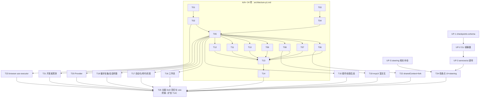

# ZCodium VS Code 插件 v0.2.0 增量架构附录（P1b：B 档 30 项 + F-58/F-72/F-73）

- 作者：架构师 高见远（Bob / software-architect）
- 输入：`docs/prd-full.md`（67 项范围定案 = A21 + A+13 + B30 + F-58 + F-72 + F-73；✕ 档 6 项不做）+ 基线 `architecture-p1.md`（T01–T14 不变）+ 实地勘察（shared/browser-use、v4 command/input-intent、zcode-cli runtime methods、services 装配）
- 性质：**纯设计稿**。本轮不改代码；UP-* 上游任务只出设计，实现另派；不触碰 `apps/zcode-vscode` 与 `zcode-cli` 源码（工程师并行 T01–T05）
- 勘察基准：`packages/shared/src/zcode-protocol-v4/command.ts|input-intent.ts`、`packages/shared/src/browser-use/*`、`apps/zcode-cli/packages/core/src/runtime/methods/{workspace-checkpoints,file-rewind,rewind-message,session-fork,workspace-fork}.ts`、`packages/services/src/node.ts|zcode-agent/zcodeAgentService.ts`

---

## 0. 结论速览

| 项 | 结论 |
|---|---|
| B 档 30 项 | **绝大部分为"装配面"工作**：@zcode/ui 已有对应 store/面板组件（pluginManagementStore、skillStore、savedWorkflowStore、automationManagementStore、offPeakTaskStore、mcpStore、DeveloperToolsPane、SettingsPage），插件侧 = 装配 + settings 面 + 少量新面板；唯一 L 级是 F-41 mcpUi 富交互（需 Webview 沙箱 iframe 承载 MCP App 实例） |
| F-08 分叉 | **上游零改动**：v4 命令面已有 `forkAssistant {target: conversationRowTargetSchema}`（command.ts L169），PRD"待核实"解除——归入 B 档插件侧任务 |
| F-73 steering | **裁决：v4 sendText `requestedDelivery:"guide"` 旗标方案**，**协议 schema 零新增**。决定性证据：`input-intent.ts` L38-53 已建模 `requested/admitted: ["auto","startNow","queue","guide"]` 与 `state: ["notRequested","submitting","steering","guided","fellBack"]`——steering 语义（含回退 fellBack）已在协议意图面 |
| F-72 检查点 | 上游需新增 v4 命令族 `session/checkpoints/list\|preview\|apply\|cascade`；runtime 实现已齐（workspace-checkpoints/file-rewind/rewind-message/workspace-fork + `WorkspaceCheckpointArtifact/Summary`），主要是重暴露 + schema。**事件面裁决：不新增 message.removed/part.removed 事件**——v4 是 revision + single-flight resync 模型（delta/apply/controller），截断由 revision 跳变触发 resync 对账，与既有 staleAuthorityRecovery/pendingCommandRecovery 机制同构 |
| F-58 browser-use | **协议零改动**：`interaction/browserList\|browserExecute` 反向请求已在 services 内路由（`zcodeAgentService.ts` L1052/L2881 → `browserControlExecutor{list,execute}`，缺省=不可用）。插件侧 = 在 `createLocalServices` 装配时注入 extension host 版 CDP executor（Node 24 原生 WebSocket，零新依赖） |

---

## 1. B 档 30 项插件侧设计

> 图例：协议面 = 插件消费的通道；复用 = @zcode/ui 现成资产（已实地盘点）；扩展 = 桥/服务面/插件侧新增。

### 1.1 插件生态与技能目录（F-43/44/45/46/47，B · M）

- **协议面**：`plugins/list|overview|referenceCatalog(+WithCategory)|listUiSurfaces|install|uninstall|update|restoreBuiltin|cancelOperation|marketplace/add|remove|update|configure|resetConfig|validate|describe|setEnabled|resolveSuggestedReference`、`plugins/operationProgress` 事件、`skills/referenceCatalog`。
- **复用 @zcode/ui**：`store/pluginManagementStore.ts`（+Enabled/Loading/Migration/StatusList 分片）、`store/skillStore.ts`、`hooks/usePlugins.ts`/`useSkills.ts`、`SlashCommandPlugin.tsx`、`settings/`（SettingsPage 表单骨架）、`pluginReferenceIconContext/projection`、`slashCommandPanelSections.tsx`。**基本零新 UI 逻辑**，装配方：插件详情页（describe→表单→configure→validate）直接用 SettingsPage 表单组件族。
- **扩展**：① 新增 `PluginPanel.tsx`/`SkillPanel.tsx` 装配页（Webview 侧栏二级视图或独立 WebviewPanel）；② `pluginManagementStore` 依赖的 host 频道经既有桥自动可用（services 已含 plugins/skills 服务）；③ `plugins/operationProgress` 事件 → store（services broadcast 已桥接）。
- **验收锚点**：prd-full AC-43-1..AC-47-2。风险低；唯一注意点：安装/卸载涉及磁盘操作发生在 extension host（services 实现），无沙箱冲突。

### 1.2 工作流（F-48/49/50，B · M）

- **协议面**：`workflows/list|get|updateMeta|delete|move|save|forRun|runs`；运行面已由 v4（`workflowRuns/workflowRunEvents/workflowRunArtifacts` 族）在 A/A+ 时间线里承载。
- **复用 @zcode/ui**：`store/savedWorkflowStore.ts`、`store/workflowRunSavedStore.ts`、`v4/WorkflowNotificationArtifactChips/ToolRow/HoleRow`、`WorkflowPermissionBlock.tsx`、`v4/savedWorkflowHubContext.tsx`、`v4/workflowRunCardJoin.ts`。
- **扩展**：`WorkflowLibraryPanel.tsx`（库列表：项目档/全局档分列 + rename/delete/move，复用 ui 列表与 ConfirmDialog 宿主）；完成卡"保存为工作流"按钮挂到 turn 完成投影（ui 已有 workflowTurnCompletion）。
- **验收锚点**：AC-48-1..AC-50-1。

### 1.3 自动化 / 闲时任务 / 灰度策略（F-51/52/26/33/34，B · M）

- **协议面**：`automation/create|list|update|delete|checkTaskBinding`、`offPeak/create|list`、`offPeakToolEnabled`、`dynamicWorkflowEnabled/Mode`、`workspace/updateOffPeakToolPolicy|updateDynamicWorkflowPolicy`。
- **复用 @zcode/ui**：`store/automationManagementStore.ts`、`store/offPeakTaskStore.ts`、`v4/OffPeakNewTaskEntry.tsx`、`ConversationBackgroundWorks.tsx`、`hooks/useDynamicWorkflowAvailability.ts`、`store/dynamicWorkflowAvailabilityStore.ts`、cron 表单可复用 SettingsPage 表单族。
- **扩展**：`AutomationPanel.tsx`（CRUD + checkTaskBinding 校验提示）；设置页高级区三灰度开关（`zcodium.experimental.offPeakTool/dynamicWorkflow/mode` → HostSettingsBridge 透传 create）；`onOffPeakSchedulerWakeRequested` 等 createLocalServices 注入点在 host 装配时传 no-op/转发（automation 调度运行在扩展宿主内，属预期）。
- **验收锚点**：AC-51-1..AC-52-2、AC-26-1..AC-34-1。**注意**：定时任务在 VS Code 关闭后不运行——文档明示"插件内自动化仅在 VS Code 运行期生效"（与桌面端差异，写进 F-51 UI 文案）。

### 1.4 Workspace 偏好全集 / 会话参数 / 运行时偏好协商（F-30/31/35/21/22/15，B · S）

- **协议面**：`workspace/updateInteractionPreferences|updateModelIoPreferences|hooks/trustGrant`；`parentSessionId`、`persistence`、`session/requestRuntimePreferences`、`subagents/readRuntimeConfig`。
- **复用 @zcode/ui**：`hooks/useSettings.ts`/`store/hooksStore.ts`/`workspaceHookReviewStore.ts`（F-35 信任弹窗 ui 已有 `WorkspaceHookPendingBanner`/`v4/WorkspaceHookReview*`）、`v4/ConversationQueuePanel`（parentSession 层级）。
- **扩展**：设置页"偏好"分组（F-30/31 表单读穿查询方法）；`persistence` 会话级开关进会话菜单；F-15 无 UI——host 侧 RuntimePreferencesResponder（默认策略应答，AC-15-1：不悬挂）；F-21 子会话"提升为独立会话"= create 带 parentSessionId + 列表层级渲染（复用 T06 会话列表）。
- **验收锚点**：AC-30-1..AC-35-2、AC-21-1..AC-22-1、AC-15-1。

### 1.5 MCP 富交互（F-40/41/42，B · L——本期最大单项）

- **协议面**：`mcp/readResource`；`mcpUi*` 15 方法（openInstance/close/validate/sampling(+cancel)/callTool(+cancel)/readResource/listResources/listResourceTemplates/subscribe/unsubscribe/registerAppTools/unregisterAppTools/claimAppToolCall/resolveAppToolCall）；`interaction/requestOfficialMcpAuthHeaders`。
- **复用 @zcode/ui**：`store/mcpStore.ts`（+Helpers/StatusList/Migration）、`gen-ui/`（MCP App 渲染基座）、`plugin-ui/`、`EmbeddedBrowserPaneParts`（沙箱容器参照）、sampling 授权卡复用 PermissionDialog 宿主模式。
- **扩展（设计核心）**：
  1. **宿主链**：services 已有 `plugin-ui-bridge` 与 shared `mcp-apps/contract.ts` 的 `PluginSandboxPlatformPort`——MCP App 实例 = 沙箱化 iframe 资源。桌面端 sandbox 落在 main 进程（`desktop/src/host/pluginSandbox/`）；插件侧落 **extension host**：App HTML/静态资源经 services 拉取后写入 `globalStorage` 目录 → 作为 `webview.asWebviewUri` 资源供独立 **沙箱 WebviewPanel**（`enableScripts` + 严格 CSP + postMessage 白名单）加载。
  2. **桥面**：主 Webview（对话）↔ App WebviewPanel 之间经 host 中转的 `mcpUi*` 信箱：callTool/claimAppToolCall 走 v4 命令链，App 侧 postMessage → host → RPC。sampling 请求进主 Webview 授权卡。
  3. **超时与幂等**：claim 后未 resolve 的 app tool call 定时器（AC-41-3 自动失败）——host 侧信箱管理器持有 pending map。
- **验收锚点**：AC-40-1..AC-42-2。**前置核实（T19 首日）**：mcp-apps contract 对 renderer 的具体要求（postMessage 形态/CSP 限制），以及 services `plugin-ui-bridge` 是否已含宿主无关实现。

### 1.6 Provider / 账户（F-53/54/55，B · M）

- **协议面**：`provider/updateAccountConfig|refreshRegistry|testModelConnectivity`、`interaction/requestProviderRuntimeHeaders`。
- **复用 @zcode/ui**：`ModelConfigSelect.tsx`、`login/`、`settings/`（凭据表单 + 掩码输入族）、`hooks/useCredentials.ts`/`useCodingPlanEntryPlanList.ts`。
- **扩展**：`ProviderSettingsPanel.tsx`（装配）；F-55/F-42 同模式——host 侧反向请求 → 主 Webview 请求卡（复用 ElicitationDialog 宿主），取消语义不悬挂。
- **验收锚点**：AC-53-1..AC-55-2。

### 1.7 观测 / sharedContext / 分叉（F-59/60/61/18/08，B · S/M）

- **F-59/60/61**：协议 `process/childProcesses|networkCapture|networkRequests|resourceSample|mcpTelemetry|toolExecResource`。**复用 `DeveloperToolsPane.tsx`**（ui 已有开发者面板骨架：进程/网络/遥测页签）——插件侧零新面板，命令面板入口 `ZCodium: 开发者工具` 打开独立 WebviewPanel 装配。采样开关生命周期跟随面板可见性（AC-61-2）。
- **F-18 sharedContext**：`session/create.importedHistory{source:"sharedContext"}`（shareId/markdown/provenance sha 校验）。复用 `ConversationShare*` 组件族（`ConversationShareReadonlyTimeline` 有 electron 引用——只读时间线在插件侧不需要，走 shareImportIntent 入口粘贴 shareId → host create）。sha 校验失败拒绝（AC-18-2）。
- **F-08 分叉**：**上游零改动**。v4 `forkAssistant {target: conversationRowTargetSchema}` 命令在案（command.ts L169）。插件侧：消息行右键/悬浮菜单"从此处分叉"→ sendCommand(forkAssistant) → ACK 返回新 sessionId → 跳转（复用 T06 切换机制）。fork 输入意图与消息克隆（`cloneMessageForFork`）由 CLI 完成。

---

## 2. F-58 browser-use 宿主执行器（纯插件侧 · L）

### 2.1 契约现状（勘察确认）

1. 反向请求面：Agent 经 `interaction/browserList`（列浏览器）与 `interaction/browserExecute`（执行 CDP 指令）反向请求宿主；`services/zcodeAgentService.ts` L1052/L2881 已把这两个请求路由到装配注入的 `browserControlExecutor { list(input), execute(input) }`（`createLocalServices` options，node.ts L1320 注释："缺省则 browser 不可用"）。**命令 schema 权威在 `packages/shared/src/browser-use/`**（`commands.ts` BrowserCommand discriminated union ~590 行、`backend.ts` BrowserBackendDescriptor、`command-metadata.ts` BrowserCommandMethod/Context、`result.ts` BrowserCommandResult）。
2. runtime 侧有 `BrowserControlPort`（runtime/types.ts import 面）——Agent 工具面按 port 可用性 + 插件（`browser-use@zcode-plugins-official`，officialPluginCache.ts L11）双条件装配。
3. **待核实点（F-58 任务首日）**：app-server 模式下 browser-use 工具面是否还需要 `--browser-use`/`--browser-executable` 旗标，还是 executor 注入 + 插件在案即启用。若需旗标 → `zcodeAgentCommandResolver`（T02 已接线 CliLocator）按 `zcodium.browser.*` 设置追加。

### 2.2 插件侧设计：`VscodeBrowserExecutor`

```mermaid
classDiagram
    direction LR
    class VscodeBrowserExecutor {
        -config: BrowserConfigStore
        -sessions: Map~string, ManagedBrowser~
        +list(input: ListInput): Promise~BrowserBackendDescriptor[]~
        +execute(input: ExecuteInput): Promise~BrowserCommandResult~
        -launchBackend(backendId): Promise~ManagedBrowser~
        -connectCdp(wsUrl: string): Promise~CdpConnection~
        -disposeAll(): Promise~void~
    }
    class ManagedBrowser {
        +backendId: string
        +child: ChildProcess
        +cdp: CdpConnection
        +crashGuard: CrashRestartGuard
    }
    class CdpConnection {
        -ws: WebSocket
        -targetId: string
        +send(method: string, params: object): Promise~unknown~
        +onEvent: Event~CdpEvent~
    }
    class BrowserConfigStore {
        +executablePath: string|undefined
        +mode: "headless"|"headed"
        +proxy: string|undefined
        +allowlist: string[]
    }
    class HostRuntime {
        +createLocalServices({browserControlExecutor: VscodeBrowserExecutor})
    }
    VscodeBrowserExecutor --> ManagedBrowser : 管理 0..n
    ManagedBrowser --> CdpConnection : 持有
    VscodeBrowserExecutor --> BrowserConfigStore : 读取
    HostRuntime --> VscodeBrowserExecutor : 装配注入
```

要点：
1. **进程管理**：`child_process.spawn(executablePath, ["--headless=new"|"", "--remote-debugging-port=0", "--user-data-dir=<globalStorage>/browser-profile"])`；端口解析读 stderr 的 `DevTools listening on ws://...`；`--remote-debugging-port=0` 由系统分配，避免端口冲突。
2. **CDP 客户端**：Node 24 原生 `WebSocket`（extension host 全局可用，零依赖）；per-target `/devtools/browser` 端点；`BrowserCommand` 的 method 判别路由到 CDP 域调用（Page/Runtime/Network/Input/Fetch），超时与取消用 AbortSignal。
3. **生命周期与崩溃回收**：崩溃 → `onExit` → 会话内 backend 描述符移除 + 有限重启（≤2 次）→ 告警；`deactivate` 时 disposeAll（杀进程树，复用基线 stdio 进程树终止经验）。
4. **安全**：`zcodium.browser.executablePath/mode/proxy`（workspace 级）；**站点 allowlist**（`zcodium.browser.allowedOrigins`）在 execute 前校验导航目标，越界拒绝并回错误结果（非抛错）；凭据/剪贴板类命令默认拒（按 BrowserCommand method 黑名单首期）。
5. **UI**：设置面板 + 执行器状态进开发者面板（F-59 同页签）；执行中的页面操作在对话时间线由既有 tool 时间线呈现（v4 已投影）。

### 2.3 工作量与拆解

executor 本体 L（CDP 路由 + 命令域映射 + 崩溃回收 + 测试桩用 fake CDP server）、配置/UX S。任务见 §5 T23。

---

## 3. F-72 检查点/回滚（上游协议设计稿）

### 3.1 runtime 实现盘点（重暴露的素材，全部已存在）

`apps/zcode-cli/packages/core/src/runtime/methods/`：
- `workspace-checkpoints.ts`（357 行）：`WorkspaceCheckpointArtifact{files}`、`WorkspaceCheckpointSummary`、`parseCheckpointCreatedPayload`、checkpoint 创建事件（SessionEventType）、`restoreWorkspaceCheckpointFiles`。
- `file-rewind.ts`（821 行）/ `rewind-message.ts`（740 行）/ `helpers/rewind.ts`（`selectCheckpointForRewind`）：作用域与策略枚举 `RewindScope`/`RewindStrategy`。
- `session-fork.ts` / `workspace-fork.ts`（`forkWorkspaceAtMessage`）：消息点分叉即"cascade"的实现基座。
- **v4 已暴露的部分**：`ConversationTransport.fileRewindPreview`（`v4/conversation/fileRewindPreview`，workspace-only 文件撤销预览）与 `forkAssistant` 命令——**F-72 缺口收窄为：checkpoint 枚举/预览/应用审批/cascade 会话回滚**。

### 3.2 v4 协议 schema 草案（新增 `packages/shared/src/zcode-protocol-v4/checkpoints.ts`）

```ts
// 风格对齐 v4 现有文件：zod strict、commandPayloadSchemas 注册、result 独立 schema。
export const checkpointSummarySchema = z.object({
  id: z.string().min(1),                 // checkpoint 权威 ID（content-addressed artifact key）
  turnId: z.string(),
  messageId: z.string(),                 // 关联消息点（cascade 锚）
  createdAt: timestampSchema,
  summary: z.string().optional(),        // preview 文本（rewind.ts previewTextFromMessage）
  fileCount: z.number().int().nonnegative(),
}).strict();

// v4/command 新增 payload（信封同既有：sessionId/baseRevision/commandId/clientId）
checkpointsList: z.object({ cursor: z.string().optional() }),
checkpointsPreview: z.object({
  checkpointId: z.string().min(1),
  fileScope: z.array(z.string()).optional(),   // 缺省=全部受影响文件
}),
checkpointsApply: z.object({
  checkpointId: z.string().min(1),
  fileScope: z.array(z.string()).min(1),
  cascade: z.boolean(),                        // true = 同时回滚会话状态到锚消息点
}),
// （cascade 不单独成命令：并入 apply.cascade，一次审批覆盖文件+会话两相，
//   避免"文件回滚了、对话没回滚"的半态——PRD §3.2 的 cascade 独立项合并理由）

// 结果 schema
checkpointsListResultSchema = z.object({ checkpoints: z.array(checkpointSummarySchema), nextCursor: z.string().nullable() }).strict();
checkpointsPreviewResultSchema = z.object({
  affectedFiles: z.array(z.object({ path: z.string(), adds: z.number().int(), dels: z.number().int() })).min(1),
  diffRef: z.string(),                          // 分块读取句柄（对齐 artifactRead 分块模式 ≤512KiB）
}).strict();
checkpointsApplyResultSchema = z.object({
  appliedFiles: z.array(z.object({ path: z.string(), restored: z.boolean() })),
  newSessionId: z.string().optional(),          // cascade=true 时回滚后的会话身份（实现定：原地 vs 新 id）
  revisionAtApply: z.number(),
}).strict();
```

### 3.3 审批与幂等/竞态边界（写入命令语义）

1. **审批强制**：`checkpointsApply` 在 CLI 执行前必须产生 `interaction/requestPermission`（kind=file_edit，聚合 affectedFiles 清单）；cascade 追加二级确认（对话回滚不可逆说明）。拒绝 → ACK `rejected`（复用 v4 命令 ACK 词表，新增 `reasonCode: checkpointApplyRejected.<reason>`）。
2. **幂等**：apply 以 `checkpointId + fileScope` 为幂等键（内容寻址 artifact 重复应用 = noop `appliedFiles[].restored:false`）；同 commandId 重放按 v4 命令去重（duplicate）。
3. **竞态**：
   - vs **turn 运行中**：busy 时 apply/cascade 拒绝（`reasonCode: checkpointRejected.turnActive`）；客户端先 `stop`。
   - vs **compact**：cascade 在 compact 后按 revision guard 拒绝（锚消息点可能已被摘要替代）；list 结果的 summary 行标注"上下文已压缩，仅文件回滚可用"。
   - vs **工具执行中**：file-rewind 既有实现内含文件写互斥（runtime 现状），命令层透传其错误。
4. **baseRevision**：apply/cascade 必带（v4 命令信封既有字段）；stale → ACK `stale`，客户端 single-flight resync。

### 3.4 事件面裁决（关键）

**不新增 `message.removed`/`part.removed` 事件**。理由：v4 rows/delta 是 append-only + `revision` 权威模型，截断的既有对账路径 = revision 跳变 → 客户端 `single-flight resync`（`conversationTransportDelayE2E`/`staleAuthorityRecovery`/`pendingCommandRecovery` 同构）。cascade 生效即 CLI 提升 revision，插件侧零新事件代码，桌面/Web 同步受益。diff/文件级回滚的呈现复用 `v4/conversation/fileChanges`。

### 3.5 上游波及文件清单（实现另派）

| 层 | 文件 | 改动 |
|---|---|---|
| shared | `packages/shared/src/zcode-protocol-v4/checkpoints.ts`（新）、`command.ts`（注册 3 payload）、`transport.ts`（结果 schema + ConversationTransport 方法签名）、`index.ts`（出口） | 新增 |
| cli | `apps/zcode-cli/packages/cli/src/server/…`（v4 命令注册/路由）、`core/src/runtime/methods/workspace-checkpoints.ts`（包装 internal 为命令处理）、`file-rewind.ts`/`rewind-message.ts`（参数适配）、`docs/` 黄金测试 | 重暴露 |
| services | `packages/services/src/zcode-agent/zcodeAgentService.ts`（v4 转发面 +3 方法）、`node.ts`（无结构改动） | 透传 |
| ui | `packages/ui/src/v4/transport.ts`（ConversationTransport +3 方法）、消息行菜单/面板（可后置，插件先行自装） | 可选 |
| 插件 | 消息级"回滚到此检查点"入口 → 预览 diff（VS Code 原生 diff）→ 审批卡 → apply → revision resync | T24-UP |

---

## 4. F-73 Steering（裁决：sendText steer 旗标方案）

### 4.1 裁决与理由

**选 v4 `sendText` + `requestedDelivery:"guide"`（插话旗标），否决独立 `session/steer` 命令。**

理由（全部有勘察证据）：
1. **协议意图面已建模 steering**：`input-intent.ts` L38-39 `requested/admitted: z.enum(["auto","startNow","queue","guide"])`、L53 `state: z.enum(["notRequested","submitting","steering","guided","fellBack"])`——"guide"投递 + steering 状态机 + fellBack 回退是既有契约，独立命令会造成同一意图两条 wire 面。
2. **命令 schema 零改动**：`sendText.requestedDelivery` 已含 `"guide"`（command.ts L101）。新增独立命令 = shared + services + ui 三层改动；旗标方案 = 上游仅验证/补全 turn-loop 行为。
3. **UI 投影免费获得**：guide 输入天然进入 rows 投影为 userInput row + intent state（steering→guided→fellBack），ui 的 `ConversationUserInputBody`/intent 渲染已识别这些状态；独立命令还需新 row 类型。
4. **对账/幂等复用**：commandId + `v4/commands/query` 重连对账对 guide 命令同样生效，独立命令需自行接入。

### 4.2 上游核实与补全项（UP-S，M 级以下）

1. **drain 语义完备性**：runtime `internal-turn-methods.ts` / turn-guide-drain（PRD §3.3 所述内部实现）确认 busy turn 中 `admitted:"guide"` 的入队-注入时机（模型输入组装点）与 `MAX_TURN_STEER_INPUT_BYTES = 200_000`（helpers/steering.ts）超限行为——**超限 → ACK rejected + reasonCode `steerInputTooLarge`**（需在 CLI 确认/补此路径）。
2. **idle 回退**：turn 已结束（notActive）时 guide → ACK `rejected/steerTurnNotActive`，客户端回退为普通 sendText（fellBack 语义），避免静默丢消息。
3. **竞态**：guide vs `stop`（stop 胜出，未注入的 guide 按 fellBack 落为 queued 或 rejected，策略写入 CLI 文档）；guide vs `compact`（compact 进行中拒绝 steering）；幂等：同 commandId 重放 duplicate，不同 commandId 的同文本不去重（用户可能刻意重复）。
4. **事件面**：无新事件；复用 rows 投影 intent.state。

### 4.3 上游波及清单

| 层 | 文件 | 改动 |
|---|---|---|
| shared | 无 schema 改动；`docs/`（guide/steer 语义 spec） | 仅文档 |
| cli | `core/src/runtime/internal-turn-methods.ts`、turn-guide-drain 相关（PRD §3.3）、命令 admission 错误词表（2 个 reasonCode）、黄金测试 | 行为确认/补全 |
| services | 无（sendText 转发已存在） | 零 |
| ui | composer 的 guide 提交（ui v4 composer 可能已有 startNow/queue 分支，补 guide 分支） | 小改或插件侧覆盖 |
| 插件 | busy 时输入框"插话"模式（发送按钮语义 + 行内提示"将在当前 turn 生效"） | T24 |

---

## 5. 修订任务列表（原 T01–T14 不变；T06–T12 按 34 项口径维持）

> 分组规则沿用 architecture-p1.md §6：每任务 ≥3 文件、验收引用 prd-full AC 编号、vitest 必过。B 档任务统一前置条件 = T05（对话数据层接线）；UP-* 为**上游仓库改动**（只出设计稿，实现另派；先合上游再接插件）。

### T15 — 插件/技能生态面板【B · F-43..F-47】
- **文件**：`src/webview-react/plugins/PluginPanel.tsx`、`src/webview-react/skills/SkillPanel.tsx`、`src/webview-react/plugins/pluginSurfaces.ts`（listUiSurfaces 跳转路由）、`src/commands/plugins.ts`、`test/pluginPanel.test.ts`
- **依赖**：T05
- **验收**：AC-43-1..2（三页签+分类过滤）、AC-44-1..3（生命周期+进度+取消+keep-data）、AC-45-1..2（市场源）、AC-46-1..2（describe 表单/validate/setEnabled）、AC-47-1..2（技能目录+插入引用）

### T16 — 工作流管理【B · F-48..F-50】
- **文件**：`src/webview-react/workflows/WorkflowLibraryPanel.tsx`、`src/webview-react/workflows/saveFromRun.ts`、`src/webview-react/workflows/runHistory.ts`、`test/workflowLibrary.test.ts`
- **依赖**：T05
- **验收**：AC-48-1..3、AC-49-1..2（forRun 已保存态）、AC-50-1

### T17 — 自动化/闲时任务与灰度策略【B · F-51/52/26/33/34】
- **文件**：`src/webview-react/automation/AutomationPanel.tsx`、`src/webview-react/settings/experimentalFlags.ts`、`src/host/hostSettingsBridge.ts`（策略方法写穿）、`src/host/runtimePreferencesResponder.ts`、`test/automationPanel.test.ts`
- **依赖**：T05
- **验收**：AC-51-1..3、AC-52-1..2、AC-26-1..2、AC-33-1、AC-34-1、AC-15-1；UI 明示"VS Code 关闭后自动化不运行"

### T18 — Workspace 偏好全集与会话参数【B · F-30/31/35/21/22】
- **文件**：`src/webview-react/settings/PreferencesPanel.tsx`（交互/IO 选项组）、`src/webview-react/settings/hookTrust.ts`（复用 ui WorkspaceHookReview*）、`src/webview-react/sessions/sessionFlags.ts`（persistence 开关 + parentSessionId 层级）、`test/preferencesPanel.test.ts`
- **依赖**：T05、T12（设置页骨架）
- **验收**：AC-30-1、AC-31-1、AC-35-1..2、AC-21-1..2、AC-22-1

### T19 — MCP 富交互 mcpUi【B · F-40/41/42 · L】
- **文件**：`src/host/mcpAppSandbox.ts`（App 资源落 globalStorage + 沙箱 WebviewPanel 供给）、`src/host/mcpUiMailbox.ts`（claim/resolve 信箱 + 超时失败）、`src/webview-react/mcp/McpAppHost.tsx`（实例面板桥 + sampling 授权卡）、`src/webview-react/mcp/mcpResourceViewer.ts`（F-40）、`src/webview-react/mcp/officialMcpAuthCard.ts`（F-42）、`test/mcpUiMailbox.test.ts`
- **依赖**：T05、T08（MCP 设置）
- **前置核实（首日）**：shared `mcp-apps/contract.ts` 的 renderer 侧要求 + services `plugin-ui-bridge` 宿主无关性
- **验收**：AC-40-1..2、AC-41-1..3、AC-42-1..2

### T20 — Provider/账户配置【B · F-53/54/55】
- **文件**：`src/webview-react/settings/ProviderPanel.tsx`、`src/webview-react/settings/connectivityTest.ts`、`src/webview-react/settings/runtimeHeaderCard.ts`、`test/providerPanel.test.ts`
- **依赖**：T05
- **验收**：AC-53-1..2、AC-54-1..2、AC-55-1..2

### T21 — 开发者观测面板【B · F-59/60/61】
- **文件**：`src/webview-react/devtools/DevToolsPanel.tsx`（装配 ui DeveloperToolsPane 于独立 WebviewPanel）、`src/host/devtoolsSamplingLifecycle.ts`（采样跟随面板可见性）、`src/commands/devtools.ts`、`test/devtoolsLifecycle.test.ts`
- **依赖**：T05
- **验收**：AC-59-1..2、AC-60-1..2、AC-61-1..2

### T22 — sharedContext 导入 + forkAssistant 分叉【B · F-18/F-08】
- **文件**：`src/webview-react/import/SharedContextImport.tsx`、`src/webview-react/timeline/forkAction.ts`（forkAssistant 命令 + 跳转）、`src/host/importSharedContext.ts`（sha 校验错误透传）、`test/sharedContextImport.test.ts`
- **依赖**：T05、T06
- **验收**：AC-18-1..2、AC-08-1..2

### T23 — browser-use CDP executor【F-58 · L】
- **文件**：`src/host/browser/executor.ts`（VscodeBrowserExecutor：list/execute）、`src/host/browser/managedBrowser.ts`（spawn + 端口解析 + 崩溃回收）、`src/host/browser/cdpConnection.ts`（Node24 WebSocket CDP 客户端 + BrowserCommand 域路由）、`src/host/browser/config.ts`（zcodium.browser.* + allowlist 校验）、`test/browserExecutor.test.ts`（fake CDP server 桩）
- **依赖**：T02（装配点）；无上游依赖（协议/注入点现成）
- **验收**：PRD §3.1 插件侧工作面 + §2.2 设计要点（进程树终止、执行中时间线投影、越界导航拒绝）；**前置核实**：app-server 下工具面是否需 `--browser-use` 旗标（是 → HostRuntime 的 CommandResolver 追加）

### UP-S — steering 上游核实/补全（上游仓库 · M↓）
- **设计稿**：§4.2/4.3（schema 零改动；turn-loop drain 语义 + 2 个 reasonCode + 黄金测试）
- **验收**：guide 投递在 busy/idle/stop/compact 四象限行为有黄金测试背书；插件 T24 只消费

### UP-1 — checkpoints v4 schema（上游 · shared）
- **设计稿**：§3.2（`zcode-protocol-v4/checkpoints.ts` 新文件 + command/transport/index 注册）
- **验收**：schema 通过仓库黄金测试框架评审；方法表登记

### UP-2 — checkpoints CLI 重暴露（上游 · cli，依赖 UP-1）
- **设计稿**：§3.5 cli 行（server 路由 + runtime methods 包装 + 审批强制 + busy/compact 竞态拒绝词表）
- **验收**：4 命令在 server-operations 注册且行为测试覆盖 §3.3 边界

### UP-3 — checkpoints services/ui 透传（上游 · 依赖 UP-2）
- **设计稿**：§3.5 services/ui 行（IZCodeAgentService +3 方法、ConversationTransport +3 方法）
- **验收**：桌面端冒烟不受影响（纯增量）

### T24 — 检查点 UI + steering 插话模式【插件 · 依赖 UP-3/UP-S】
- **文件**：`src/webview-react/timeline/checkpointMenu.ts`（消息级"回滚到此检查点"）、`src/webview-react/checkpoints/previewDiff.ts`（VS Code 原生 diff 承载 diffRef 分块）、`src/webview-react/checkpoints/applyFlow.ts`（审批 → apply → revision resync → cascade 跳转）、`src/webview-react/composer/steerMode.ts`（busy 时插话发送 + 提示文案）、`test/checkpointFlow.test.ts`
- **依赖**：UP-3、UP-S
- **验收**：对标 CC rewind 交互：list→preview（affectedFiles diff）→审批→apply→（cascade）会话回滚到锚点并 resync；steering：busy 发送走 guide、ACK rejected(turnNotActive) 自动回退普通发送

### 修订依赖图



> **T14 与 T25 关系**：T14 保留为 A/A+ 34 项 DoD 收口；范围扩至 67 项后 T14 的打包/回归职责延展为 T25（全量 AC 抽样回归 + vsix 体积门禁复验——B 档面板进 bundle 后重审 §7 预算，mcpUi 沙箱资源走 globalStorage 不进 bundle，预期增量可控）。

---

## 6. 风险补充（衔接 architecture-p1.md §8，仅列新增项）

| # | 风险 | 缓解 |
|---|---|---|
| R8 | mcpUi 沙箱在 WebviewPanel 内的 CSP/iframe 嵌套限制（Webview 内再嵌 iframe 的能力边界） | T19 前置核实项；降级：MCP App 实例改用独立 WebviewPanel（顶层）承载，对话内以引用卡跳转 |
| R9 | B 档面板把 webview bundle 推过 §7 预算 | 面板按 dynamic import 分块（`webview.cspSource` 白名单本地资源目录，已在 §7 预留）；SettingsPage/表格组件按需 |
| R10 | CDP executor 稳定性（有头/无头差异、企业代理、Chrome 版本漂移） | 默认 headless=new + allowlist；`zcodium.browser.executablePath` 允许指向企业标准浏览器；命令域路由按 shared BrowserCommand schema 版本对齐，schema 外命令显式 unsupported |
| R11 | 上游 UP-* 排期不可控导致 T24 阻塞 | T24 独立于 T15–T23；上游未合入前插件以 capabilities 探测隐藏入口（F-72/73 均有优雅缺席态），不阻塞 T25 的其余 65 项 DoD |
| R12 | `session/checkpoints/*` 与 runtime 内部实现签名偏差（设计稿基于 357/821/740 行文件的方法面推断） | UP-2 实现前做一次 runtime 方面对照评审（设计稿 §3.1 已列全部素材文件），偏差回写本附录 |

