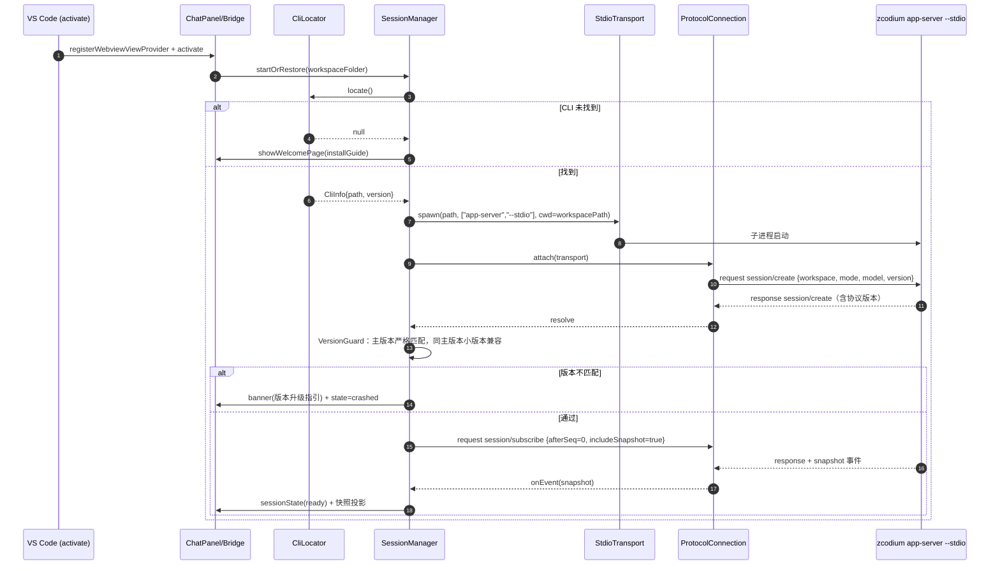
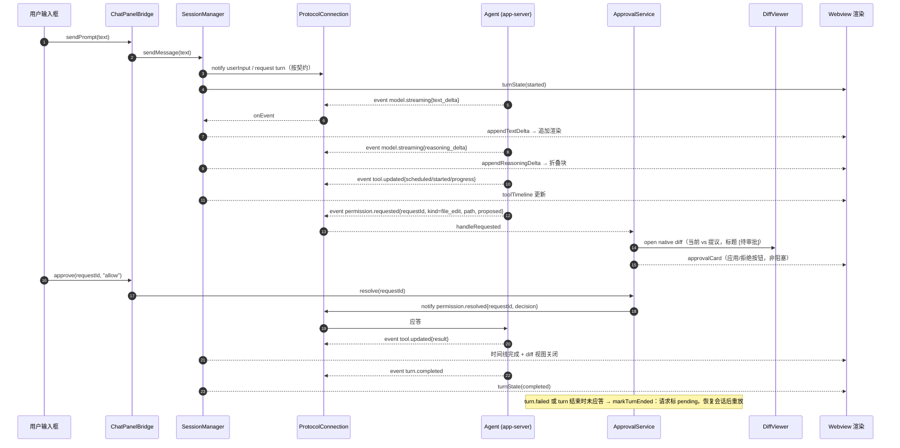

# ZCodium VS Code 插件（apps/zcode-vscode）架构设计与任务分解

- 作者：架构师 高见远（Bob / software-architect）
- 输入：`docs/prd.md`（许清楚）+ 主理人已拍板决策 + 仓库勘察事实
- 遵循：`AGENTS.md`（先 spec 后代码、契约唯一所有者、依赖方向、maxFileLines 800）

---

## 1. 实现方案与框架选型

### 1.1 核心技术挑战

1. **纯协议消费方约束**：插件不 import 任何 `@zcode/*` 内部模块。协议契约（`packages/shared/src/zcode-protocol/index.ts`，4500 行 zod schema）只能在插件内**手工同步一份最小子集**（本插件用到的：传输帧、session create/resume/subscribe、事件 envelope、snapshot、permission）。这是唯一允许的"复制"，必须用注释标明来源行号并纳入验收检查。
2. **stdio 帧解析的正确性**：参考实现 `zcodeStdioTransport.ts` 的经验必须复刻——帧边界只认 LF（readline 会把 U+2028/U+2029 当换行，模型文本会切坏帧）；CRLF 兼容（去尾部 `\r`）；大帧（快照可达 ~15MB）必须用分片数组 O(n) 成帧，不能整缓冲 indexOf；空行跳过；解析失败 → 连接关闭（`protocol_parse_error`），而不是静默丢帧。
3. **进程生命周期**：正常退出边界是 stdin EOF（不是 kill）；dispose 流程 = `stdin.end()` → 短宽限（参考实现 1800ms）→ 进程树兜底终止；stderr 只收集用于诊断，永不参与协议解析。
4. **审批流的可靠性**：permission 请求/应答要幂等（同 requestId 重复 resolved 忽略）、非阻塞（不弹模态）、turn 结束后未应答请求标记 pending 待恢复重放；"本次会话允许"需插件侧维护会话级 allowlist 缓存。
5. **会话恢复**：插件只存会话 ID（globalState/workspaceState），恢复全部走协议 resume + 订阅（afterSeq/includeSnapshot），插件不持久化任何业务消息。

### 1.2 选型结论

| 项 | 结论 | 理由 |
|---|---|---|
| 扩展宿主 | VS Code Extension API（Node.js extension host，非 Web Extension） | 需要原生 child_process、Diff 编辑器、workspace API；MVP 不支持 web/remote 场景（写入"待明确"） |
| UI | WebviewView（侧栏 viewContainer）+ Vanilla TS，**不引 React** | 包体积与构建复杂度可控；聊天面板消息流为追加式渲染，vanilla 足够；P2 再评估 Vite+React |
| 打包 | esbuild 双入口（extension.js / webview main.js），`external: ["vscode"]` | 与 CLI 同款工具链；单文件产物让 .vsix 内**零 node_modules** |
| .vsix 打包 | `@vscode/vsce`（devDependency，`vsce package` 脚本） | 事实标准；配合 `.vscodeignore` 排除 src/node_modules，vsix 只含 dist + media + package.json |
| 帧校验 | **zod（bundle 进 extension.js）**，与手工同步的类型并存 | zod 纯 JS 可被 esbuild 内联（压缩后 ~60KB，vsix 无 node_modules 负担）；保留运行时校验能在协议漂移时给出明确错误（对齐 G3）；收益大于体积代价。**结论：用** |
| 类型 | `@types/vscode@^1.90.0` + TS strict | engines.vscode 主理人已拍板 `^1.90.0` |
| 测试 | vitest（包内自带 config，走根 vitest 生态） | 帧解析/状态机/审批流用内存 fake stdio 双端测试，不起真进程 |
| Lint | oxlint + oxfmt（沿用根配置） | 仓库统一 |

### 1.3 架构模式

分层 + 事件驱动（无 MVC 框架）：

```
extension.ts（薄壳 activate/deactivate）
  └─ container.ts（装配）
       ├─ CliLocator          → 探测 CLI（settings 路径 → PATH）
       ├─ StdioTransport      → spawn + 帧编解码（FrameCodec）
       ├─ ProtocolConnection  → 请求-响应关联 / 事件分发 / 超时 / 错误码
       ├─ SessionManager      → 状态机 + 创建/恢复/崩溃重启（唯一会话状态所有者）
       ├─ ApprovalService     → permission 生命周期（唯一审批状态所有者）
       ├─ ChatPanel + WebviewBridge → Webview 消息桥（双向消息协议）
       ├─ DiffViewer / StatusBar / Diagnostics / WelcomePage
       └─ ExtensionStore      → globalState/workspaceState（只存会话 ID）
```

依赖方向单向：`ui → session/approvals → protocol → transport`；protocol 层不知道 VS Code API（可独立 vitest 测试），webview 代码不 import 任何 node 模块。

---

## 2. 包结构与文件列表

全部相对 `apps/zcode-vscode/`：

```
apps/zcode-vscode/
├── package.json                  # engines ^1.90.0、contributes、scripts（build/package/test）
├── tsconfig.json                 # extends 根 tsconfig.base.json
├── esbuild.mjs                   # 双入口打包脚本（extension.js + webview/main.js）
├── .vscodeignore                 # 排除 src/test/node_modules，vsix 只留 dist+media
├── vitest.config.ts
├── README.md                     # 安装/配置/CLI 引导说明
├── media/
│   └── zcodium.svg               # Activity Bar 图标
├── src/
│   ├── extension.ts              # activate/deactivate 薄壳（<100 行）
│   ├── container.ts              # 依赖装配 + dispose 顺序
│   ├── config.ts                 # settings 读取：zcodium.cliPath/model/mode/showReasoning/allowlist
│   ├── store.ts                  # ExtensionStore：globalState/workspaceState，只存会话 ID
│   ├── zcodeProtocol/
│   │   ├── types.ts              # 手工同步的协议类型+zod 子集（文件头注释标明契约来源）
│   │   └── errorCodes.ts         # JSON-RPC 标准码 + 插件侧错误码表
│   ├── protocol/
│   │   ├── frameCodec.ts         # LF 帧边界、CRLF、大帧分片、U+2028 兼容
│   │   ├── stdioTransport.ts     # spawn、stdout/stderr/stdin、EOF 退出、dispose 进程树
│   │   └── protocolConnection.ts # requestId 生成、pending map、超时、事件分发
│   ├── session/
│   │   ├── sessionStateMachine.ts# inactive→starting→handshaking→ready→busy→crashed→restarting
│   │   └── sessionManager.ts     # 创建/恢复(状态ID)/重启退避/版本守卫/事件投影
│   ├── approvals/
│   │   └── approvalService.ts    # permission.requested→resolved；幂等；会话级 allowlist；pending 重放
│   ├── ui/
│   │   ├── chatPanel.ts          # WebviewViewProvider（CSP、资源 URI、生命周期）
│   │   ├── webviewBridge.ts      # 双向消息协议（ExtToWeb / WebToExt 联合类型）+ 转发
│   │   ├── diffViewer.ts         # 原生 diff 编辑器 + 审批命令条
│   │   ├── statusBar.ts          # 状态栏（状态机颜色/角标 ⚠ pending 数）
│   │   ├── diagnostics.ts        # OutputChannel（stderr 尾部、帧错误）+ 错误横幅
│   │   └── welcomePage.ts        # CLI 未安装引导页（安装命令 + 重新检测）
│   └── webview/
│       ├── main.ts               # webview 入口（vanilla TS，无 node 依赖）
│       ├── state.ts              # webview 侧消息流状态机（追加式）
│       ├── render.ts             # 渲染调度（diff patch 消息流）
│       ├── parts/
│       │   ├── messageList.ts    # 用户/Agent 消息 + text_delta 流式
│       │   ├── reasoningBlock.ts # reasoning_delta 折叠块（显示开关）
│       │   ├── toolTimeline.ts   # tool.updated 任务时间线
│       │   ├── approvalCards.ts  # diff/命令审批卡片（应用/拒绝、允许一次/会话允许/拒绝）
│       │   └── turnBanner.ts     # turn 进行中/完成/失败 + 重试按钮
│       └── styles.css
└── test/
    ├── fakes/fakeAgentServer.ts  # 模拟 app-server 的内存 stdio 双端（回放脚本化事件）
    ├── frameCodec.test.ts
    ├── protocolConnection.test.ts
    ├── sessionStateMachine.test.ts
    ├── sessionManager.test.ts    # 版本守卫、resume、崩溃重启退避
    ├── approvalService.test.ts   # 幂等、超时、allowlist、pending 重放
    └── integration.test.ts       # fake server 全链路：建会话→turn→审批→完成
```

仓库侧改动（见 §9 登记清单）：`pnpm-workspace.yaml`、根 `package.json` typecheck、`architecture-policy.yaml`。

---

## 3. 数据结构与接口

```mermaid
classDiagram
    direction LR

    class FrameCodec {
        -pendingChunks: string[]
        -decoder: StringDecoder
        +feed(chunk: string | Buffer): void
        +flush(): string[]
        -emitFrame(frame: string): void
        +onFrame: (frame: string) => void
        +onFatal: (reason: string) => void
    }

    class StdioTransport {
        -child: ChildProcess
        -codec: FrameCodec
        -stderrTail: string[]
        +spawn(command: SpawnRequest): Promise~void~
        +send(message: ZCodeProtocolMessage): Promise~void~
        +dispose(): Promise~void~
        +onMessage: Emitter~ZCodeProtocolMessage~
        +onClose: Emitter~TransportCloseEvent~
    }

    class ProtocolConnection {
        -nextRequestId: number
        -pending: Map~number, PendingRequest~
        +request(method: string, params: unknown, timeoutMs?: number): Promise~unknown~
        +notify(method: string, params: unknown): void
        +handleMessage(msg: ZCodeProtocolMessage): void
        +onEvent: Emitter~SessionEventEnvelope~
        +onClose: Emitter~void~
    }

    class CliLocator {
        +locate(): Promise~CliInfo~
        -probePath(customPath?: string): Promise~CliInfo | null~
        -readVersion(path: string): Promise~string~
    }

    class SessionStateMachine {
        +state: SessionUiState
        +transition(event: StateEvent): SessionUiState
        +onTransition: Emitter~StateChange~
    }

    class SessionManager {
        -connection: ProtocolConnection
        -store: ExtensionStore
        -versionGuard: VersionGuard
        -restartAttempt: number
        +start(workspacePath: string): Promise~void~
        +resumeOrRestore(workspacePath: string): Promise~void~
        +sendMessage(text: string): Promise~void~
        +handleSessionEvent(evt: SessionEventEnvelope): void
        +restart(reason: string): Promise~void~
        +dispose(): Promise~void~
        +onSessionEvent: Emitter~SessionEventEnvelope~
        +onUiState: Emitter~SessionUiState~
    }

    class ApprovalService {
        -pending: Map~string, PendingApproval~
        -sessionAllowlist: Set~string~
        +handleRequested(req: PermissionRequested): void
        +resolve(requestId: string, decision: ApprovalDecision): void
        +markTurnEnded(turnId: string): void
        +isSessionAllowed(toolKey: string): boolean
        +onApproval: Emitter~ApprovalUpdate~
    }

    class ChatPanelBridge {
        +post(msg: ExtToWebviewMessage): void
        +onWebviewMessage(handler: (msg: WebviewToExtMessage) => void): void
        +resolveWebviewSource(): Uri
    }

    class DiffViewer {
        +open(requestId: string, file: string, proposed: string): Promise~void~
        +close(requestId: string): void
    }

    class ExtensionStore {
        +getSessionId(scope: "global" | "workspace"): string | undefined
        +setSessionId(id: string | undefined): void
    }

    StdioTransport --> FrameCodec : 组合
    ProtocolConnection --> StdioTransport : 读写帧
    SessionManager --> ProtocolConnection : 使用
    SessionManager --> SessionStateMachine : 内部状态
    SessionManager --> ExtensionStore : 会话 ID 持久化
    SessionManager --> CliLocator : start 前探测
    ApprovalService --> ProtocolConnection : 应答 permission.resolved
    ChatPanelBridge --> SessionManager : sendPrompt/retry
    ChatPanelBridge --> ApprovalService : resolve/openDiff
    ChatPanelBridge --> DiffViewer : 打开原生 diff
```



关键约定：

- `SessionManager` 是**唯一**会话状态所有者；webview 不保存事实，只渲染投影。
- `ApprovalService` 是**唯一**审批状态所有者；`resolve` 幂等（重复 requestId 忽略并告警）。
- `FrameCodec` 无 VS Code / Node 子进程依赖，纯函数式可测。
- 协议类型集中在 `src/zcodeProtocol/types.ts`，其他模块不得自行定义协议形状。

---

## 4. 程序调用流程

### 4.1 激活 → 探测 CLI → spawn → 握手 → 建会话 → 订阅



### 4.2 用户消息 → 流式 → 工具 → diff 审批 → turn.completed



命令审批（P0-8）走同一 permission 通道：卡片展示命令全文 + 三按钮（允许一次 / 本次会话允许→写 `sessionAllowlist` / 拒绝），危险命令（写系统路径、rm 类）升级 `window.showWarningMessage`。

---

## 5. 任务列表（T1–T9）

> 原则：先契约与可测内核（T2–T4 纯 TS，vitest 全覆盖），再接 VS Code 壳（T5–T8），最后集成打包（T9）。T2/T3 可并行。

### T1 — 包基础设施与工程登记
- **文件**：`apps/zcode-vscode/package.json`、`tsconfig.json`、`esbuild.mjs`、`.vscodeignore`、`vitest.config.ts`、`src/extension.ts`（可激活空壳）、`media/zcodium.svg`、`README.md`；仓库登记改动（§9：pnpm-workspace.yaml / 根 typecheck / architecture-policy.yaml）
- **依赖**：无
- **优先级**：P0
- **验收**：`node scripts/check-workspace-freshness.mjs` 通过；`pnpm install` 后 `pnpm --filter zcode-vscode build` 产出 `dist/extension.js`；`pnpm typecheck` 全仓通过；`vsce package` 产出 .vsix 且包内无 node_modules；VS Code 加载空扩展可激活（contributes 的 view 容器出现）。
- **覆盖需求**：—（基础设施）

### T2 — 协议契约层：手工同步类型 + 帧编解码
- **文件**：`src/zcodeProtocol/types.ts`、`src/zcodeProtocol/errorCodes.ts`、`src/protocol/frameCodec.ts`、`test/frameCodec.test.ts`
- **依赖**：T1
- **优先级**：P0
- **验收**：types.ts 文件头注明契约来源（`packages/shared/src/zcode-protocol/index.ts`，标注同步日期与所需 schema 清单）；帧测试覆盖：LF 边界、CRLF 尾 `\r`、跨 chunk 大帧（>1MB，分片成帧 O(n)）、U+2028/U+2029 不切帧、空行跳过、非法 JSON → onFatal(`protocol_parse_error`)、EOF 尾部残帧 flush。
- **覆盖需求**：P0-2（帧解析部分）、G3（契约解耦）

### T3 — CLI 探测与 stdio 传输
- **文件**：`src/cli/cliLocator.ts`、`src/protocol/stdioTransport.ts`、`src/config.ts`、`test/fakes/fakeAgentServer.ts`
- **依赖**：T1
- **优先级**：P0
- **验收**：settings `zcodium.cliPath` 优先 → PATH 探测 → 返回 null；transport 测试（用 fake stream/子进程桩）覆盖：发送帧写 stdin、stderr 收集为尾部环形缓冲、EOF（stdout end/close）→ onClose（正常退出码路径）、dispose = stdin.end() → 宽限 → 终止、写入已关闭 transport 抛错。
- **覆盖需求**：P0-1、P0-2（spawn/stderr/EOF）

### T4 — ProtocolConnection + 会话状态机
- **文件**：`src/protocol/protocolConnection.ts`、`src/session/sessionStateMachine.ts`、`test/protocolConnection.test.ts`、`test/sessionStateMachine.test.ts`
- **依赖**：T2、T3
- **优先级**：P0
- **验收**：request/response 按 id 关联（含超时 reject `E_REQUEST_TIMEOUT`）、notification→事件分发、错误响应映射错误码表；状态机单测覆盖全部合法/非法转移（非法转移抛错不改状态）。
- **覆盖需求**：P0-2（请求层）、P0-9（状态基础）

### T5 — SessionManager + ApprovalService + 版本守卫
- **文件**：`src/session/sessionManager.ts`、`src/approvals/approvalService.ts`、`src/store.ts`、`test/sessionManager.test.ts`、`test/approvalService.test.ts`
- **依赖**：T4
- **优先级**：P0
- **验收**：create 携带 workspace/mode/model（MVP 单会话=第一个 workspace folder）；resume：store 有会话 ID → session/resume + subscribe(afterSeq, includeSnapshot)，无 → 新建；崩溃重启指数退避（250ms×2^n，上限 10s，5 次后停自动重启仅留手动）；版本守卫（主版本严格、同主小版本兼容，不匹配→crashed+明确错误）；审批幂等（重复 resolved 忽略）、turn 结束未应答→pending、`本次会话允许` 写 allowlist；restore 后 pending 重放。全部走 fakeAgentServer 集成测试。
- **覆盖需求**：P0-3、P0-8（语义）、P0-10（守卫逻辑）、P1-8（断线恢复内核）

### T6 — Webview 基建 + 消息桥 + 聊天核心
- **文件**：`src/ui/chatPanel.ts`、`src/ui/webviewBridge.ts`、`src/webview/main.ts`、`src/webview/state.ts`、`src/webview/render.ts`、`src/webview/parts/messageList.ts`、`src/webview/parts/reasoningBlock.ts`、`src/webview/styles.css`
- **依赖**：T5
- **优先级**：P0
- **验收**：WebviewView 打开（CSP 只允许 panel 本地资源）；双向消息协议类型完整（ExtToWebviewMessage / WebviewToExtMessage 联合）；输入框发送→`sendPrompt`；text_delta 追加渲染、reasoning_delta 折叠块 + "显示思考过程"开关（configuration `zcodium.showReasoning`）；会话就绪/未就绪输入态切换。
- **覆盖需求**：P0-4、P0-5

### T7 — 工具时间线 + turn 生命周期 + 状态栏/诊断
- **文件**：`src/webview/parts/toolTimeline.ts`、`src/webview/parts/turnBanner.ts`、`src/ui/statusBar.ts`、`src/ui/diagnostics.ts`
- **依赖**：T6
- **优先级**：P0
- **验收**：tool.updated 五态渲染为时间线（scheduled/started/progress/result/error/batch）；turn.started/completed/failed 驱动 UI（进行中 spinner / 完成 / 失败+可读错误+重试按钮）；状态栏随状态机变色（running 绿 / busy / crashed 红）+ pending 审批角标 ⚠ n；OutputChannel 记录 stderr 尾部与帧错误。
- **覆盖需求**：P0-2（状态显示）、P0-6、P0-9

### T8 — 审批 UI：原生 diff + 命令审批卡片
- **文件**：`src/ui/diffViewer.ts`、`src/webview/parts/approvalCards.ts`、`src/ui/welcomePage.ts`（引导页顺带在此提交）、`src/container.ts` 接线
- **依赖**：T5、T7
- **优先级**：P0
- **验收**：文件编辑审批打开 VS Code 原生 diff（left 磁盘 / right 提议，标题 `[待审批] file.ts`），应用→resolved(allow)→Agent 写入→diff 关闭提示；拒绝→resolved(reject)→Agent 继续对话；命令审批卡片三按钮（允许一次/本次会话允许/拒绝）+ 命令全文；危险命令升级警告对话框；审批全程非阻塞（内联卡片+状态栏角标）。
- **覆盖需求**：P0-7、P0-8（UI）、P0-1（引导页）

### T9 — 集成、契约核对与打包
- **文件**：`src/extension.ts` 全链路 wiring、`src/container.ts`、`test/integration.test.ts`、`esbuild.mjs` 终稿、`README.md`、.vsix 打包脚本
- **依赖**：T1–T8
- **优先级**：P0
- **验收**：① 全链路集成测试（fakeAgentServer）：激活→建会话→流式→工具→审批→turn.completed；② 手工端到端：真机安装 .vsix + zcodium CLI，未配置即完成 PRD DoD 闭环；③ 契约核对：对照 `packages/shared/src/zcode-protocol/index.ts` 逐 schema 核对 types.ts（清单写入 PR 描述）；④ `pnpm typecheck && pnpm lint` 通过；⑤ 异常路径：CLI 缺失引导页、协议不匹配升级指引、崩溃自动恢复均有可见提示。
- **覆盖需求**：P0-1、P0-10（UI）、DoD 全项

### P0 需求覆盖映射

| PRD 需求 | 覆盖任务 |
|---|---|
| P0-1 激活与 CLI 探测 | T3（探测）、T8（引导页）、T9（集成） |
| P0-2 进程生命周期 | T2（帧）、T3（spawn/stderr/EOF）、T4（请求层）、T5（重启退避）、T7（状态栏） |
| P0-3 会话创建 | T5 |
| P0-4 聊天 Webview | T6 |
| P0-5 流式与推理 | T6 |
| P0-6 工具可视化 | T7 |
| P0-7 diff 审批 | T8（UI）、T5（语义） |
| P0-8 命令审批 | T5（语义）、T8（UI） |
| P0-9 turn 生命周期 | T4（状态机）、T7 |
| P0-10 协议版本守卫 | T5（逻辑）、T9（升级指引） |

---

## 6. 依赖包列表

**dependencies（运行时）**

```
- zod@^3.23.8: 协议帧运行时校验（esbuild 内联进 extension.js，不产生 node_modules 依赖）
```

**devDependencies**

```
- @types/vscode@^1.90.0: 扩展 API 类型（与 engines.vscode 对齐）
- @types/node@^24: Node 类型（mise.toml: node 24.14.0）
- typescript@^5.x: 与根版本一致
- esbuild@^0.25.x: 打包（与 CLI 同款）
- @vscode/vsce@^3: .vsix 打包
- vitest@^3.x: 测试（版本对齐根 workspace）
```

**vsix 打包外置策略**

- esbuild `bundle: true`，`external: ["vscode"]`；zod 内联 → `dist/extension.js` 单文件。
- webview 入口独立 bundle 为 IIFE `dist/webview/main.js`，`format: "iife"`、`target: es2022`、零 import。
- `.vscodeignore` 排除 `src/**`、`test/**`、`node_modules/**`、`*.ts`、配置文件 → **.vsix 内零 node_modules**，规避 vsce 依赖树打包的所有坑。
- 禁止任何需要 native binding 的运行时依赖（如 node-pty）——终端执行展示由 Agent 侧完成，插件不需要 pty。

---

## 7. 共享知识（跨文件约定）

1. **帧解析边界**（`frameCodec.ts`，语义对齐参考实现 `zcodeStdioTransport.ts` 但代码独立）：
   - 帧边界**只认 LF**；禁止 readline（U+2028/U+2029 是合法 JSON 字符串内容）。
   - 兼容 CRLF：成帧后剥掉行尾单个 `\r`。
   - 大帧分片：未完成行存 chunk 数组，遇 LF 才 join 一次（快照可达 ~15MB，禁止整缓冲扫描）。
   - 空行（trim 后为空）跳过；EOF 时 flush 尾部残帧再报 close。
   - JSON 解析失败或 zod 校验失败 → `onFatal("protocol_parse_error")` → 连接关闭进崩溃恢复，不静默丢帧。
   - stderr **永不**进入帧解析，仅收集尾部环形缓冲（如 200 行）供诊断输出。
2. **请求 id**：`ProtocolConnection` 单调递增整数（从 1 起），连接内唯一；连接重建后重置（不存在跨连接引用）。pending map 在 onClose 时全部以 `E_TRANSPORT_CLOSED` reject。
3. **错误码表**（`errorCodes.ts`）：
   - JSON-RPC 标准保留码：-32700 parse error、-32600 invalid request、-32601 method not found、-32602 invalid params、-32603 internal。
   - 插件侧码（1xxx 段，仅插件内部 UI 呈现用）：`1001 E_CLI_NOT_FOUND`、`1002 E_PROTOCOL_VERSION_MISMATCH`、`1003 E_PROTOCOL_PARSE`、`1004 E_REQUEST_TIMEOUT`（默认 30s）、`1005 E_SESSION_CRASHED`、`1006 E_PERMISSION_UNKNOWN_REQUEST`、`1007 E_TRANSPORT_CLOSED`。
4. **连接状态机**（`sessionStateMachine.ts`，UI 呈现的唯一事实）：
   ```
   inactive → starting → handshaking → ready ⇄ busy
                │           │              │
                ▼           ▼              ▼
              crashed ◀──（spawn 失败/版本不符/意外退出）──┘
                │
                ▼  自动重启（退避 250ms×2^n ≤10s，5 次后停止）
            restarting → handshaking → ready
   ```
   - busy → ready 仅由 turn.completed / turn.failed 触发。
   - stdin EOF 且无 in-flight turn 视为正常退出 → inactive（dispose 路径）；有 in-flight 或非 dispose 期退出 → crashed。
   - 任何状态收到 deactivate → dispose：stdin.end() → 1.8s 宽限 → 进程树终止。
5. **审批语义**：`permission.requested` 以 requestId 幂等；重复 resolved 忽略并记 warning；"本次会话允许"按 `工具类型+命令/路径前缀` 归一化为 allowlist 键，随会话生命周期（会话重建即清空）；turn 结束未应答 → pending，resume 后经快照/重放重新呈现；不做自动超时拒绝（PRD §7.3）。
6. **存储**：globalState 存跨窗口会话 ID（按 workspace folder 键控）；workspaceState 备用。除会话 ID 与 UI 偏好（reasoning 开关）外不持久化任何业务数据。
7. **文件行数**：任何文件 ≤800 行（maxFileLines）；types.ts 若接近上限按域拆分（`types/frames.ts`、`types/session.ts`）。
8. **中文注释**：bug 修复、状态所有权、时序关键点必须用中文注释说明原因（AGENTS.md 要求）。

---

## 8. 待明确事项

| # | 事项 | 推荐（默认按此实现） |
|---|---|---|
| 1 | 握手与版本校验的具体方法/字段位置（session/create 响应 vs 快照 version 字段 vs 专用 version 方法） | T5 实现前以 `packages/shared/src/zcode-protocol/index.ts` 实测为准；设计上已抽象为 VersionGuard，方法名不影响架构。版本常量 `ZCODE_PROTOCOL_VERSION = 1` 已确认存在。 |
| 2 | 用户输入下发用的准确方法名（notify vs request，input/steer 语义） | 同上，T5 前核对 schema；SessionManager 收敛为单一 `sendMessage` 入口，替换方法名不动上层。 |
| 3 | Web Extension（远程/浏览器）支持 | MVP 不支持（child_process 不可用），`engines.vscode` 不加 web 声明；P2 评估。 |
| 4 | 危险命令清单（升级警告对话框的判定规则） | MVP 用保守静态规则（rm -rf、写 `$HOME` 外系统路径、sudo、git push --force）；P1 可配置化。 |
| 5 | 插件包名 | 建议 `zcode-vscode`（目录名）/ display name `ZCodium Agent`，发布 ID 待主理人定（P2 Marketplace 才关键）。 |

---

## 9. 工程登记清单（仓库侧改动，照做即可）

### 9.1 `pnpm-workspace.yaml` — packages 列表追加一行

```yaml
packages:
  - apps/dev-docs
  - packages/*
  - apps/zcode-cli
  - apps/zcode-cli/packages/*
  - apps/zcode-cli/tools/*
  - apps/zcode-vscode        # ← 新增
```

### 9.2 根 `package.json` — typecheck（tsc -b 项目引用列表）加入新包

在 typecheck 脚本的项目引用序列中追加 `- apps/zcode-vscode`（与现有 `- packages/...` 条目同样写法）；同时确认 `tsconfig.base.json` 的 composite/paths 约束对新包不产生隐式依赖要求（本插件不引用 `@zcode/*`，无需 paths 别名）。

### 9.3 `architecture-policy.yaml` — 登记新模块

```yaml
  # zcode-vscode：VS Code 扩展，纯协议消费方（只与 zcodium app-server --stdio 的 JSON 帧交互，
  # 不 import 任何 @zcode/* 内部模块），协议类型为手工同步子集。
  - id: zcode-vscode
    roots:
      - apps/zcode-vscode/src
    managed: true
    requires: []
    publicEntrypoints:
      - apps/zcode-vscode/src/extension.ts
      - apps/zcode-vscode/src/zcodeProtocol/types.ts
    owner: conversation
```

- `requires: []` 是硬约束：任何 import `@zcode/*` 会被 architecture:check 拦截（符合主理人决策）。
- 登记后跑 `pnpm architecture:check --changed` 确认通过。

### 9.4 开发前检查

任何任务动工前先跑 `node scripts/check-workspace-freshness.mjs`（AGENTS.md 要求），确认基线新鲜。
