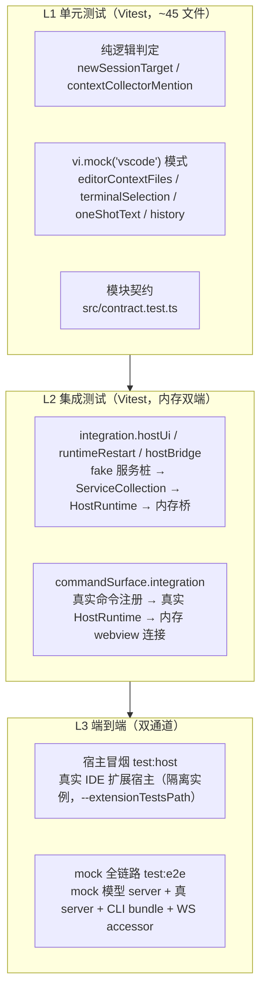

# apps/zcode-vscode 测试方案（三层全自动）

> 本文是该扩展包测试面的权威说明（spec）：三层各自测什么、用什么框架、为什么、
> 本地与 CI 怎么跑。行为契约见 `src/CONTRACT.md`；真机回归清单见 `test/e2e.checklist.md`；
> 根级 affected/门禁机制见 `docs/testing/pre-push-hook.md`（仓库根）。

## 一、分层架构

| 层 | 覆盖面 | 断言事实源 | 时长 |
|---|---|---|---|
| L1 单元 | 命令/收集器/桥帧的**纯逻辑**与模块契约 | 函数输入输出 | 秒级 |
| L2 集成 | 跨模块接线：命令 → 帧 → webview 连接投递语义 | 真实 HostRuntime 的内存连接收帧 | 秒级 |
| L3 E2E-宿主 | 部署产物在**真实扩展宿主**里激活/视图/命令/页签语义 | `ext.exports.__hostSmokeProbe`（容器只读探针） | ~1 分钟 |
| L3 E2E-全链路 | 真 server + agent + 模型通道的**完整对话链路** | RemoteServiceAccess 远程调用的 7 项验证 | ~2 分钟 |

## 二、框架选择依据

| 层 | 框架 | 为什么 |
|---|---|---|
| L1/L2 | **Vitest**（仓库既有） | ① 与根套件同 runner：`vitest.config.ts` 的 `vscode-ext` project 接入后自动受 `test:unit`、affected 选择（`scripts/run-affected-unit-tests.mjs` 消费 Vitest 官方 changed/related API）、unit-nightly、coverage 保护；② ESM/TS 原生、`vi.mock("vscode")` 模式已确立；③ 零新增依赖。**不用** jest：无既有投入且与根套件割裂 |
| 守卫类 | **node:test**（既有） | no-telemetry / sqlite-schema 等静态守卫沿用仓库 push 级轻量锚点惯例，不进 Vitest（`nodeRunTestFiles` 名单同源判定） |
| L3-宿主 | **真实扩展宿主 `--extensionTestsPath`**（既有） | VS Code API 只能在宿主内真实验证（激活/视图/页签）；隔离实例 headless 可跑。断言不使用 `vscode.window.tabGroups`（隔离实例对 webview 页签跨进程同步不可靠，实测在案），改用容器只读探针 |
| L3-全链路 | **mock 模型 server 探针**（既有模式，esbuild bundle 后运行） | 真 server + agent 子进程 + 假 Anthropic API：零外部依赖、可重复；客户端走 `@zcode/client RemoteServiceAccess`——与扩展 webview 同一消费栈。**不用** Playwright/CDP 直驱 webview：webview 是 Electron guest（OOPIF），CDP eval 拿不到聊天 DOM（实测在案），且引入新依赖与脆弱的坐标耦合 |

包源码经 `.js` 后缀 ESM 相互引用，Node 无法直接加载，故 L3-全链路沿用仓库探针的
`esbuild --bundle --platform=node` 前置步骤（产物 `*-bundle.mjs` 已 gitignore）。

## 三、本地命令（apps/zcode-vscode）

| 用途 | 命令 | 说明 |
|---|---|---|
| L1+L2 单测/集成 | `pnpm --filter gode test` | 包级 vitest（含 contract.test.ts；providerConfigSeed 只在此处跑） |
| 根套件视角 | `pnpm vitest run --project vscode-ext`（仓库根） | 与根 test:unit 同一收集口径（1 文件排除见 vitest.config.ts 注释） |
| 受影响单测 | `node scripts/run-affected-unit-tests.mjs --files <改动文件>`（仓库根） | 与 pre-push hook 同机制；`--dry-run` 只看选择 |
| L3 宿主冒烟 | `pnpm --filter gode test:host` | 需本机 Antigravity IDE（`ZCODE_IDE_APP` 可指路）；默认验收已部署副本 `~/.antigravity-ide/extensions/gode.gode-0.2.0`（先 `pnpm build && ./scripts/deploy.sh`），验仓库产物用 `ZCODE_DEPLOY_DIR="$PWD"` |
| L3 mock 全链路 | `pnpm --filter gode test:e2e` | 需先 `pnpm --filter @zcode/server build`；退出码 0/1/2（全过/失败/前置缺失） |
| 定向待审链路 | `pnpm --filter gode test:pending-changes` | 既有分组入口 |
| 全量（谨慎） | `pnpm test`（仓库根） | 根 vitest 全量，含 vscode-ext project |

## 四、CI 接线

| 时机 | Workflow | 内容 |
|---|---|---|
| push（任意分支） | `.github/workflows/ci.yml` | typecheck → lint → 三包 node:test → **扩展包 vitest（新增）** → no-telemetry |
| 每晚 03:00 / 手动 | `.github/workflows/unit-nightly.yml` | job `unit`：根 vitest 全量（含 vscode-ext project）；job `e2e-mock-full`（新增）：build server → `test:e2e` |
| PR（路径过滤） | `sqlite-schema.yml` | 既有，不动 |

pre-push hook（`pnpm verify:pre-push`）不变：affected 选择自动覆盖 vscode-ext project
的测试（`--files` 传入扩展源码文件即可命中，见下方验证记录）。

## 五、约束与惯例（新增测试时必读）

1. L1/L2 的 vscode mock 用 `vi.mock("vscode")` + `vi.hoisted` 承载可变状态与类
   （vi.mock 工厂在静态 import 期执行，模块级 const 会 TDZ）。参照
   `test/commandSurface.integration.test.ts` 文件头注释。
2. L2 的内存 webview 连接必须先 attach、后发 `plat-evt: notifyRendererReady`；
   attach 顺序决定 `pushToActiveHostFrame` 的投递目标（后 attach 者为「最近活动」）。
3. 宿主冒烟新增断言只用探针（`ext.exports.__hostSmokeProbe`），不新增 src 面。
4. E2E mock 拓扑的数据根隔离依赖三件套：`.zcodium-root.json` 归属标记、
   `v2/provider_config.json`、`ZCODE_STORAGE_DIR` 指向隔离根——缺一会崩（原因见
   `e2e/e2e-mock-full.mjs` 内注释）。
5. 测试文件命名：单测 `test/<主题>.test.ts`；集成放 `test/*.integration.test.ts` 或
   既有同主题文件；不进 vitest 的 node:test 脚本须登记根 `vitest.config.ts` 的
   `nodeRunTestFiles`。

## 六、验证记录（2026-11-20）

- 根套件：`vitest run --project vscode-ext` → 44 文件 / 509 用例全绿；
  `run-affected-unit-tests.mjs --files apps/zcode-vscode/src/features/editorCommands.ts --dry-run`
  → 命中 `vscode-ext/forks: composerEntrySurface.test.ts`（affected 接入生效）。
- 本轮新增：L1 四文件 21 用例、L2 一文件 9 用例全绿。
- `test:e2e`：mock 全链路 7/7 PASS（真 server + CLI bundle + WS accessor）。
- `test:host`：真实扩展宿主 PASS（含 2026-11-19 门控回归场景 A/B）。
