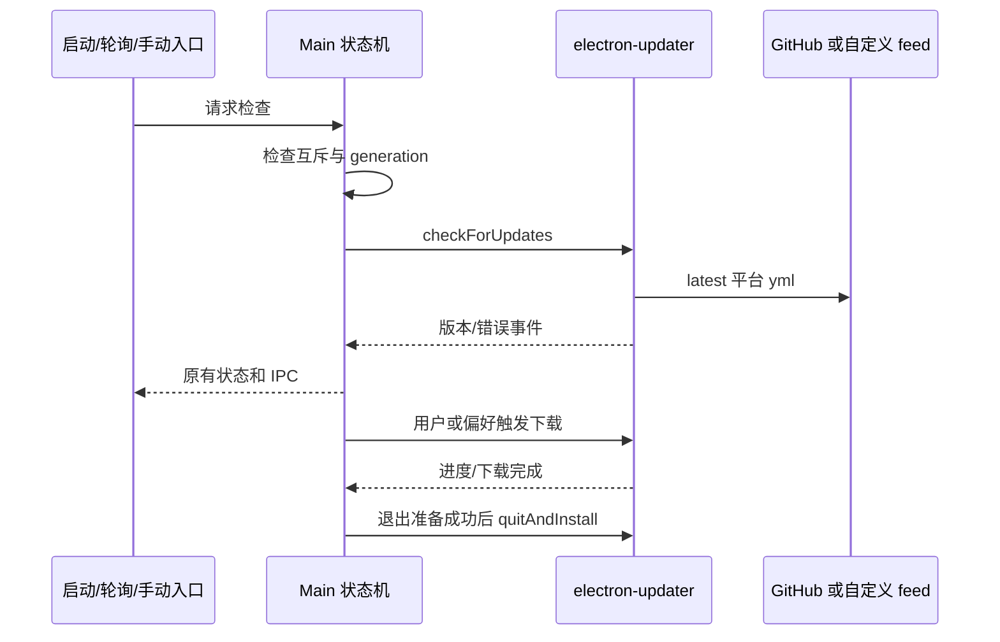

# ZCodium 桌面更新

## 规则与边界

- Main `autoUpdater.ts` 是更新状态、检查互斥、下载取消和安装调度的唯一所有者；UI 和 IPC 载荷不变。
- 使用 electron-updater 内置 generic provider，默认根地址为 `https://github.com/ZCodium-project/ZCodium/releases/latest/download/`。
- `initAutoUpdater` 每次初始化都必须显式 `setFeedURL`；打包产物里的 `app-update.yml` 只是 electron-builder 的构建占位，不能作为运行时 feed 来源。`electron-builder.config.js` 的 `publish.url` 必须与默认 feed 一致，不得写入 `localhost` 等不可达地址。
- 读取 latest.yml、latest-mac.yml、latest-linux.yml（非 x64 Linux 使用 updater 原生架构后缀）；元数据中的文件路径、校验和与下载安装由 updater 处理。macOS 自动更新需要发布 ZIP 等原生 updater 所需资源，不能只有 DMG。
- 启动参数 `--zcode-update-feed-url` 优先于 `ZCODE_UPDATE_FEED_URL`，开发及打包环境均可覆盖为 generic feed 根目录。覆盖不再接受旧官方 manifest API 语义。
- 默认只发布 latest 稳定通道，preview 偏好不会切换到官方接口或请求 preview.yml；版本跳过归属 stable。保留现有 preview 产品禁用更新的边界。
- 检查状态、结果归属与跳过版本查询统一固定为 stable；旧设置中的 `receivePreviewUpdates=true` 不触发重新检查，也不将 latest 结果标记为 preview。
- 当前 macOS 发布包未签名，固定使用手动安装模式（仅打包态 darwin，开发态和 Windows/Linux 原生安装不变）。Main 在 update-available 状态携带可选 `manualInstall: true`，UI 明确说明“此 macOS 版本未签名，无法自动安装；请前往下载对应架构的 DMG，退出应用后替换安装”，主按钮为“前往下载并手动安装”，隐藏自动下载安装偏好与重启入口。
- 手动安装模式中 Main 不因已保存的自动下载偏好而调用原生下载，不恢复旧缓存的 ready 状态，不响应原生下载完成而进入可安装态。用户主动点击 DownloadUpdate 时只通过 Main 打开固定官方 Releases 下载页，成功/失败均释放 UI 按钮，不退出应用、不调用 quitAndInstall、不在后台自动打开网页。
- Main 是安装模式和状态唯一所有者。字段缺省保持现有原生流程；UI 不按系统类型自行猜测安装能力。启动/轮询→Main 判定新版→广播 manualInstall available→UI 提示→用户点击→既有 DownloadUpdate IPC→Main shell.openExternal→ACK/错误→按钮解锁；不新增持久化状态或 Host/mobile 协议。
- 已安装旧版本的 localhost feed 无法自动获取修复，发行说明和 issue 回复必须要求用户至少手动安装一次新版。签名发布与真正的 macOS 自动安装另行跟踪。
- 删除自定义 ManifestUpdateProvider 与更新链路对官方 endpoint/device ID 的依赖。保留启动检查、每小时轮询、手动入口、原生下载与安装流程。
- `maybeBlockStartupForForceUpdate` 保留签名及调用点，直接返回 `{ blocked: false }`；不读取配置、不调用注入的 fetch、不展示弹窗、不触发回调。
- `requestForceAutoUpdate` 保留签名及 disposer，成为无副作用 no-op。
- 元数据缺失、网络失败及校验错误沿用现有错误状态，不回退官方服务。登录、分享、反馈等连接不在本轮范围。

## 事件顺序

不新增持久化所有者，不改 Host/mobile stream 协议。检查 generation、取消 token 和安装互斥沿用现有状态机。

## 验收

- 执行真实更新模块的边界替身测试：默认 generic URL、生产环境覆盖优先级、启动/手动检查、更新事件及下载/安装 IPC 保持可用。
- 执行内置 GenericProvider，验证各平台 yml 请求和相对安装包 URL 解析。
- 守卫在注入会抛错的网络/阻塞回调时仍返回不阻塞；强制更新入口无网络、无状态回调。
- `pnpm typecheck`、`pnpm lint`、架构检查通过；真实签名安装包升级需发布后另行验证。
