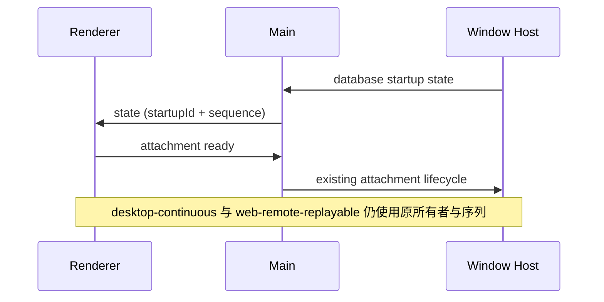

# Open Audit：桌面端无遥测

桌面端不初始化 ARMS、OTLP、使用事件上报、网络观测或定时资源遥测；环境变量与远端配置不得重新开启这些出口。删除 SDK、专属 patch、采集模块及 preload/IPC 上报桥。

本地 logger、用户主动反馈与日志导出、业务网络请求和用户主动打开的资源管理器保留。共享平台接口及桌面适配器已删除 report 方法，不保留空操作遥测桥。

唯一业务所有者不变：Host 管理数据库启动与会话，Main 转发端口与状态，Renderer 展示。删除旁路观察者，不改变 owner/lease、workspaceIdentity、attachment 代际和去重规则。

崩溃采集模块整体删除，连同其自定义 dump 归档、OOM 注解和周期清理；已有日志与磁盘文件不删除。错误仍由现有 logger 记录。

验收：指定文件与生成物不存在；无 ARMS/OTLP 导出依赖或入口；数据库 ready/failed 转发、OAuth 深链投递和远程连接不依赖遥测；根目录 typecheck 和 lint 通过。实际桌面端运行验证受本机环境约束时单独说明。

静态防回归接线（2026-10-31）：`pnpm test:no-telemetry` 依次执行 desktop / ui / cli 三份 `no-telemetry.test.mjs`，纳入 `verify:pre-push` 与 ci.yml；仓库级关键词守卫 `scripts/ci/ci-telemetry-keyword-guard.test.mjs`（vitest unit include，随全量单测与 nightly 执行）扫描 packages/apps/scripts 的源码与全部 package.json 依赖。禁词表与豁免清单在该守卫文件内维护，豁免仅限：打包排除清单（bundle.mjs / electron-builder.config.js，把 SDK 挡在产物外）、测试替身与注释、守卫自身的断言串、RPC 现有遥测导出面（`packages/rpc/src/network-telemetry-middleware.ts`，桌面不得消费，删除属独立决策）与 `packages/shared/src/server-remote.ts` 的上游 payload 兼容 schema 字段（仅解析不产生上报）。
